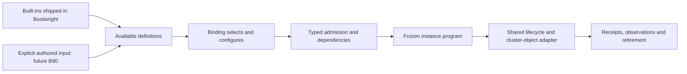

# Add-ons: architecture, API and CLI audit

Reviewer: Codex, with independent operator/API, developer/architecture and
distribution reviews. Assessment date: 2026-10-29. Product baseline:
`2f35ee8c3a57e2addef246c1c395c8ec43559e62`. Scope: add-on discovery,
selection, defaults, lifecycle, developer extension and optional distribution.
This is a source-and-test assessment, not a live-cluster qualification.

The accompanying archive move changes no prior finding disposition. Earlier
reports and follow-ups now live under [001-spec](../001-spec/README.md).
Only audit documents and relocation references change in this delivery;
local checkout/cache prefixes in one historical log are also redacted.
Recommendations below are proposals; no product contract or milestone status
is changed. Evidence line numbers refer to the product baseline.

Reading order: [assessment](#assessment), [current journeys](#current-journeys),
[findings](#findings), [recommended design](#recommended-design),
[delivery sequence](#delivery-sequence), [verification](#verification-and-limits).

## Assessment

Bootwright has a sound shared execution foundation for reviewed, built-in
add-ons. Its operator experience is still a bootstrap configuration workflow,
and its developer experience is still a source contribution workflow. Neither
currently provides a general way to install an arbitrary add-on into an
already running Bootwright-managed cluster.

**Default availability already works:** the executable carries its built-in
catalog; installation requires an effective binding selection, which may
inherit authored Environment defaults. Keep that distinction.
**Optional installation works before the initial operation is frozen:** select
the desired packages in the input, then use the ordinary lifecycle. **Adding
a new selection after a completed apply does not work:** the global lifecycle
refuses changed input. Downloading packages, adding a catalog or improving
profiles cannot by itself solve that limitation.

The highest-value changes are clearer discovery and first-use guidance, early
validation fixes, an accurate developer recipe, the existing add-on preflight
work, and a minimally scoped authored-package implementation. If “as needed”
means after cluster bootstrap completes, a separately designed additive
lifecycle is essential. It must preserve existing ownership and recovery
guarantees.

Two defects were reproduced without effects: fractional-second timeouts pass
compilation but fail planning, and a generic package namespace declaration
works only while the package has the special name `gitops`. Other findings
below distinguish source-confirmed extension limits and usability improvements
from deliberate product boundaries.

### What is already strong

- A package is a pure descriptor with normalization, admission and rendering
  hooks. All ordinary packages share the instance capability and cluster-object
  adapter; another OLM operator does not need another execution engine.
  See [Package and Rendered](../../internal/addons/packages.go),
  [instance composition](../../internal/addons/instance/render.go) and
  [capability](../../internal/addons/instance/capability.go).
- Closed typed configuration rejects unknown members. Registry/schema parity,
  deterministic ordering, duplicate selection and capability-cycle checks
  protect both authors and operators. See
  [schema](../../api/v1alpha1/addons.go),
  [selection](../../internal/addons/instances.go) and
  [registry tests](../../internal/addons/packages/registry_test.go).
- OLM installation is explicit about the channel and exact CSV. The runtime
  preserves ownership receipts, checks foreign objects, borrows credentials
  through custody, and resolves uncertain outcomes. Existing
  [lifecycle journeys](../../internal/reconciliation/lifecycle/addon_journey_test.go)
  cover lost outcomes, partial receipts, drift, settlement and retirement.
- Catalog listing is local and derived from the registry and API schema. It
  neither installs a package nor needs a cluster connection. This is the right
  starting point for better discovery.

### Current capability boundary

This is an assessed snapshot, not a new maintained package inventory; the
[registry](../../internal/addons/packages/registry.go) and
[coverage owner](../../specs/add-on-coverage.md) remain authoritative.

| Operator or developer need | Behavior at the baseline | Assessment |
| --- | --- | --- |
| Discover included packages | `add-ons list` reports `acm`, `fdf`, `gitops`, `kubevirt`, `metallb`, `nmstate` | Implemented; availability is independent of selection |
| Install a built-in during bootstrap | Configure `ClusterAddonBinding.spec.packages` for a cluster the context builds | Implemented in-tree; live qualification remains separately tracked |
| Choose release/configuration | Typed package input; explicit channel and `startingCSV`; package-specific defaults | Implemented; no default vendor release should be inferred |
| Run a predeclared package later | Continue an incomplete staged/paused apply over unchanged input | Implemented; different from adding a selection later |
| Add a package after a completed apply | Changed input is refused | Intentional lifecycle limit; A01 |
| Install into an independently existing cluster | No add-on target that accepts an arbitrary existing kubeconfig | Outside the current cluster-produced credential model |
| Reuse built-in selections through `ClusterAddonProfile` | Profiles contain authored references, not `packages` | Intentional API decision; A03 |
| Supply custom OLM/manifests without rebuilding | Authored definitions are admitted, but selected authored packages refuse execution | B90 remains unimplemented; A02 |
| Check native add-on prerequisites before execution | `preflight add-ons` reports `cli.not-implemented` | Known B770 gap; A05 |
| Remove one add-on online | No supported online uninstall | Parked B769; whole-context removal retires instances |
| Use cert-manager/GitLab built-ins | Specified future packages, absent from the executable registry | B767/B93, not delivered catalog entries |

## Current journeys

### Operator: from catalog to a selected package

The current local discovery command is:

```sh
bootwright add-ons list --output json
```

An operator then authors a binding within the complete desired-state universe.
For example, this is the existing NMState selection shape; the channel and CSV
below are deliberately illustrative and require replacement with operator
choices from the intended catalog:

```yaml
apiVersion: bootwright.io/v1alpha1
kind: ClusterAddonBinding
metadata:
  name: node-network-operator
spec:
  clusterRef: demo
  packages:
    nmstate:
      subscription:
        channel: example-channel
        startingCSV: kubernetes-nmstate-operator.v0.0.0
```

Omission of `nmstate` from the effective binding means no NMState instance.
Its presence is a selection with required configuration, not an enable flag.
An empty package object does not supply the required subscription choices.
Schema and package normalization defaults fill selected configuration without
selecting additional packages. Authored
[Environment kind defaults](../../specs/api/environment.md#kind-defaults)
are different: `defaults.ClusterAddonBinding.packages` can supply omitted
package members to an existing binding. They never create a binding. The
[NMState example](../../examples/add-ons/lab-sno-nmstate/README.md) gives the
native PackageManifest lookup used to find a channel and CSV.

The operator validates the full input, initializes the context and reviews its
effective state, origins and plan, then executes the ordinary staged lifecycle as the
[operator guide](../../docs/operator-guide.md) and
[example journey](../../e2e/lab-sno/runbook.md) describe. `--stage` and
`--until <cluster>.<package>` can defer predeclared work; they do not make a
changed frozen operation mutable. `status` reports recorded progress and
`diff --observe` can inspect supported live observations. Repeating a settled
apply contacts no cluster and does not repair drift.

Inspect both normalized values and their provenance before planning:

```sh
bootwright render effective --context demo
bootwright render effective --context demo --origins
```

Environment defaults already support a common bundle across existing bindings,
but their merge semantics matter for optional selections. Source evidence is
[defaults.go](../../internal/desiredstate/compilation/defaults.go), lines
16–24 and 53–59, and
[binding admission](../../internal/addons/bindings.go).

| Authored binding value when Environment supplies package defaults | Effective behavior |
| --- | --- |
| `packages` omitted | Inherits the default package map |
| Nonempty `packages` with an omitted package member | Inherits that member too; explicit nested values win |
| `packages: {}` | Suppresses all package inheritance; a binding with no other selection then fails validation |
| `nmstate: {}` | Still selects NMState, blocks its inherited configuration and fails required subscription validation |
| `nmstate: null` | Invalid type; not a disable marker |
| Two bindings on the same cluster inherit the same package | Duplicate-instance refusal |

There is no per-package subtraction marker. Use kind defaults for a common
bundle with disciplined binding structure, and templates for selectively
different bundles. A future preset feature must improve on these existing
semantics rather than duplicate them under another name.

There are three different inventories to communicate: packages available in
the executable, instances selected in desired state, and instances recorded
as installed or observed. The current catalog lists only the first. It should
not be presented as installed state.

Removal also needs explicit wording. The current inverse retires the instance
with its cluster without deleting Kubernetes objects through the API. On a
physical cluster that survives context destruction, add-on objects and placed
Secrets can remain unmanaged. A successful destroy is not an add-on uninstall;
see [retirement](../../specs/add-ons.md#retirement).

### Developer: the supported contribution path

A new reviewed built-in normally needs:

1. A typed configuration and closed schema member in
   [the API owner](../../api/v1alpha1/addons.go), with omission/default rules.
2. A descriptor and pure renderer in the
   [package implementation directory](../../internal/addons/packages/), using
   [NMState](../../internal/addons/packages/nmstate.go) as the small reference.
   Package-specific admission/normalization belongs with that descriptor.
3. Registration in [Builtin](../../internal/addons/packages/registry.go),
   actual capability requirements and provided tokens only where consumed by
   a domain rule or the API, and bounded native operations
   and readiness checks through the existing cluster-object program.
4. Typed-decoding/admission cases, deterministic render and plan evidence,
   shared qualification checks and examples. The authoritative requirements
   remain [package qualification](../../specs/add-ons.md#package-qualification).
5. A deliberate request/content-digest assessment and a separate live
   acceptance gate. A changed rendered request can prevent continuation of an
   earlier frozen operation; see
   [continuation after a fix](../../.agents/knowledge/continuation-after-a-fix.md).

An ordinary package does not need a new CLI dispatcher, lifecycle binding,
playbook or Ansible role. A novel operation outside the closed program may need
a reviewed shared seam. A new vendor release alone is not a reason to copy an
implementation or introduce a release-support matrix.

This path is feasible but difficult to discover from the development entry
point. It also contains two generic extension defects and a test-harness
limitation, detailed below. Authored YAML currently provides no alternative
execution path for developers outside the Bootwright source tree.

## Findings

Priority describes impact on the requested experience. A P1 product gap is
not a claim of a security vulnerability or an implementation regression.
Line references identify inspected evidence, including counterevidence.

| ID | Priority | Classification | Finding |
| --- | --- | --- | --- |
| A01 | P1 | Intentional product limit | New add-on selections cannot be applied after completed bootstrap |
| A02 | P2 | Planned capability gap | External declarative packages cannot yet execute |
| A03 | P2 | Intentional API limit | Profiles cannot reuse executable built-in selections |
| A04 | P2 | Operator UX improvement | Catalog discovery stops before a usable configuration |
| A05 | P2 | Known deferred work | Add-on preflight is unavailable |
| A06 | P2 | Reproduced defect | Fractional-second timeout is accepted but cannot plan |
| A07 | P2 | Reproduced extension defect | Placement authorization depends on a package-name exception |
| A08 | P3 | Source-confirmed test limitation | Shared package goldens assume OLM and omit the Before phases |
| A09 | P3 | Ownership inconsistency | Generic normalization knows MetalLB-specific fields |
| A10 | P2 | Developer UX improvement | No concise add-on contribution entry point |

### A01 — Optional after bootstrap requires a new lifecycle scenario

**Evidence:** [execution.go](../../internal/reconciliation/lifecycle/execution.go),
lines 597–606 and 649–652, rejects changed input after completed apply and
offers destroy followed by apply. [render.go](../../internal/addons/instance/render.go),
lines 62 and 78, requires the context-built cluster's produced kubeconfig and
installation dependency. There is no independent add-on-only existing-cluster
target in this path.

**Impact:** selecting MetalLB, GitOps or another package after baseline cluster
completion cannot be a routine incremental operation. Configuration or CSV
changes also cross the frozen-input boundary. A package catalog cannot fix it,
and another context cannot simply adopt the existing cluster.

**Counterevidence:** unchanged staged continuation and `--until` are supported;
the [until tests](../../internal/reconciliation/lifecycle/until_test.go) prove
pause/resume. The
[three-scenario tests](../../internal/reconciliation/lifecycle/transitions_spec_test.go)
and [reconciliation contract](../../specs/state-reconciliation.md) deliberately
preserve exact continuation. This is a product choice, not a missing branch to
silently enable.

**Correction:** first expose the limitation in the add-on entry journey.
If post-bootstrap installation is required, define one bounded additive
scenario with prior-operation ownership, fresh prerequisite proof, retained
credential authority, crash recovery and later destroy semantics. Imported
external clusters are a separate target/authority decision.

**Exit evidence:** complete a cluster without packages, add one permitted
instance, and prove its plan/effects do not rerun machine or installer work.
Prove repeat settlement, partial-failure continuation, refusal of changes to
existing instances and foreign objects, and correct removal reachability across
both operations. Keep upgrade and uninstall out of that first scenario.

### A02 — Third-party declarative extension remains B90

**Evidence:** [selection.go](../../internal/addons/instance/selection.go),
lines 19–23, refuses every bound authored `ClusterAddon` with an explicit
remedy. [B90](../../specs/milestones/m4.md#b90) is Needs definition/not started,
scheduled after M4f. Its intended route compiles authored OLM or frozen
manifest-set data into the existing cluster-object program.

**Impact:** an add-on author must currently contribute reviewed code and ship
a new Bootwright build. Installing a YAML definition into an input directory
does not produce a runnable extension. Public definition/profile kinds can
otherwise make the feature appear more complete than it is.

**Counterevidence:** plan/apply refuse unsupported content; it is not silently
ignored. Built-ins are intentionally released code. D173 retired catalog
registration, and B90 explicitly says the input tree is the source. The older
[deferred design](../../specs/deferred/add-ons-design.md) is not authority to
revive the old `add`/`delete` catalog or arbitrary drivers.

**Correction:** deliver minimal B90 before designing a general marketplace:
explicit local definitions and bounded assets, stable frozen identity, the
existing program and trust boundary. Resolve payload freezing, configuration
and qualification questions first; keep arbitrary controller-executed hooks out.

**Exit evidence:** custom OLM and manifest-set packages pass production
compilation, fake-cluster failure/continuation cases and an operator gate.
Unselected definitions cause no effect; payload changes after freezing cannot
change an operation; unsafe paths, secret literals and executable content are
refused according to the owning trust contract.

### A03 — Profiles are not built-in presets

**Evidence:** [addons.go](../../api/v1alpha1/addons.go), lines 89–96,
puts `profileRefs`/`addonRefs` in profiles and `packages` only in bindings.
[Q26](../../specs/milestones/m4.md#m4a-open-decisions) deliberately chose that
shape. The authored packages profiles select still meet A02's refusal.

**Impact:** operators cannot use the public profile kind to reuse a runnable
set of built-ins across clusters. They can use Environment kind defaults for
common values/selections, duplicate bindings or use input templates. Defaults
apply to every binding, so they are not selectively named presets.
“Acceptance profile” also means an example topology/run,
which is unrelated to the `ClusterAddonProfile` kind.

**Counterevidence:** recursive profile expansion and cycle checks exist, and
the lack of package fields is an accepted design choice. Adding package
inheritance without precedence rules would introduce ambiguity.

**Correction:** label these concepts explicitly and supply reusable binding
templates now. Only amend Q26 when a real repeated configuration warrants
typed built-in presets. Define conflict refusal, override precedence,
normalization and effective-output provenance before adding that API.

**Exit evidence:** present-day examples never claim profiles execute built-ins.
For future presets, test nested expansion, incompatible CSVs/configuration,
duplicate instances, cycles and binding overrides. Do not make `addonRefs`
implicitly resolve built-in names.

### A04 — Listing is useful but insufficient for first use

**Evidence:** [catalog/service.go](../../internal/addons/catalog/service.go),
lines 29–41, exposes top-level configuration member names only. The
[listing golden](../../internal/cli/testdata/cli-add-ons-list.golden)
cannot explain required nested channel/CSV choices, Secret reference types,
readiness, retirement or configuration-dependent requirements.

**Impact:** an operator learns that a package exists, then must locate several
other documents to produce a valid binding. `REQUIRES: none` can be mistaken
for no prerequisites, although that column describes package capabilities,
not cluster, storage, entitlement or access prerequisites. FDF's absent default
catalog also needs an explicit next step.

**Counterevidence:** the list is intentionally a catalog, is deterministic,
supports structured output and derives configuration names from the schema.
Existing package examples give the missing information. Do not turn catalog
listing into a hidden network or installed-state query.

**Correction:** add a local schema-backed package description or equivalent
linked guidance: purpose, required paths, defaults, example binding, conditional
requirements, readiness/removal semantics and qualification link. A proposed
`add-ons describe <name>` is one possible surface; it is not implemented.
State that channel/CSV selection remains the operator's responsibility.

**Exit evidence:** descriptions agree with schema/defaults and remain usable
offline without a context. Unknown names produce a remedy. Text and JSON have
stable semantics; available, selected and installed state stay distinct.

### A05 — Native preflight remains unavailable

**Evidence:** [preflight/service.go](../../internal/addons/preflight/service.go),
lines 18–22, returns `ErrNotImplemented`;
[commands_addons.go](../../internal/cli/commands_addons.go), lines 15–16,
marks the command unavailable. A direct invocation returned exit 1 with
`cli.not-implemented`. The
[command owner](../../specs/cli/commands.md#inspect-and-lifecycle-commands) and
[B770](../../specs/milestones/backlog.md#b770) already identify this work.

**Impact:** native catalog/CSV availability, API access and conflicting objects
can first fail during the add-on execution phase, after expensive bootstrap.
Static validation cannot establish these live facts.

**Counterevidence:** this is an honest unavailable command, not a successful
stub. Runtime checks still enforce ownership and exact installation. Some
checks are inherently impossible until the target cluster exists.

**Correction:** implement the existing read-only preflight scope, showing which
checks are static, observed, or unavailable until cluster readiness. Give a
clear staged journey for performing those checks before the instance starts.

**Exit evidence:** absent catalog/CSV, unreachable API and insufficient access
produce actionable structured results. Tests prove no create, patch or delete
and no secret bytes in either output stream. B770 currently bounds checks to
API access, CatalogSource readiness and CSV availability; foreign-object
detection is a possible later expansion requiring definition, not an existing
B770 commitment. Preflight success does not promise that a later install cannot
race or fail.

### A06 — Package timeout validation and planning disagree

**Evidence:** [lexical.go](../../api/v1alpha1/lexical.go), lines 134–136,
accepts positive Go durations; [instances.go](../../internal/addons/instances.go),
lines 205–208, checks positivity and the maximum only.
[render.go](../../internal/addons/instance/render.go), lines 30–31, then
requires integral seconds. [selection.go](../../internal/addons/instance/selection.go),
lines 30–47, recognizes only four rendering-bound error strings when reporting
unsupported shapes and suppresses this error there.

**Reproduction:** an otherwise valid NMState binding with `timeout: 1500ms`
compiles, returns no unsupported-shape refusal, and fails capability planning
with `package nmstate timeout must use whole seconds`. The
[API duration contract](../../specs/api/addons.md#built-in-packages) does not
state this extra restriction.

**Impact:** validated input cannot plan, and the operator gets a late error
instead of a precise field and remedy. The render guard prevents execution;
this finding does not claim unsafe partial installation.

**Correction:** agree on the duration contract. The smallest fix is to reject
nonintegral seconds at admission with `api.value`, the exact timeout field,
and a remedy, and document that resolution. Alternatively support a clearly
specified conversion without silently shortening the requested budget.

**Exit evidence:** cover `500ms`, `1500ms`, `1s`, `1.5m`, `5h50m` and the
over-limit case through production compilation and planning. `1.5m` is 90
whole seconds and must not be rejected merely for containing a decimal.

### A07 — Generic namespace permission becomes a GitOps special case

**Evidence:** [Package](../../internal/addons/packages.go), line 36, declares
`PlacementNamespaces`; [render.go](../../internal/addons/instance/render.go),
line 53, uses it when freezing a program. The same render calls request
canonicalization, whose [Objects](../../internal/addons/instance/requests.go),
lines 60–63, reconstructs the allowlist only for package name `gitops`.
The [placement contract](../../specs/add-ons.md#owned-secrets) allows a
registry-declared operator namespace.

**Reproduction:** the GitOps descriptor with a repository credential renders
successfully. Changing only its descriptor name to `fixture`, retaining the
same declared operand namespace and program, fails canonicalization with
`invalid source or namespace`. Thus a second package cannot use the same
declared mechanism without an edit to general runtime code.

**Counterevidence:** existing GitOps placement tests pass. Namespaces created
by the program also work. This is an extension defect for operator-created
namespaces, not evidence of a current GitOps failure or a permission bypass.

**Correction:** preserve generic placement authorization across the frozen
request validation boundary. Do not solve it by accepting arbitrary input
namespaces or growing a package-name switch. The fix needs a trust-boundary
review and an explicit request/content-digest decision.

**Exit evidence:** two synthetic packages with different declared operand
namespaces render and decode without name-specific code; undeclared
destinations and tampered requests fail. Preserve existing credential-placement
and continuation-contract evidence.

### A08 — Qualification harness narrows the extension seam

**Evidence:** [golden_test.go](../../internal/addons/packages/golden_test.go),
lines 127–151, iterates every built-in, dereferences `p.OLM.Namespace` twice,
and composes only `rendered.After`. Production
[render.go](../../internal/addons/instance/render.go), lines 37–55,
supports optional OLM and both phase groups.

**Impact:** a valid manifest-only built-in would require repairing the universal
test harness before joining it; a new Before phase is absent from that generic
golden. This is a limitation of this test, not proof that all other plan or
package-specific tests miss those operations.

**Counterevidence:** all current built-ins use OLM, and none currently populates
Before. Existing package and full-plan goldens therefore pass.

**Correction and exit evidence:** make the reusable harness handle optional
OLM and both phase groups, preferably by exercising production instance
composition. A synthetic non-OLM case and a Before/After case should round-trip;
changes to either phase should alter its expected program, while approval order
remains pinned.

### A09 — MetalLB normalization belongs behind its existing hook

**Evidence:** [instances.go](../../internal/addons/instances.go), lines 155–164,
defaults/sorts MetalLB pools by package-name branch immediately before calling
the generic `Package.Normalize` hook. The
[MetalLB descriptor](../../internal/addons/packages/metallb.go) has no normalizer;
[GitOps](../../internal/addons/packages/gitops.go) demonstrates the hook.

**Impact:** the generic selection path teaches contributors a competing place
to add package policy. Current behavior is correct; this is a small ownership
inconsistency rather than an installation defect.

**Correction and exit evidence:** move that transformation into MetalLB's
normalizer with byte-identical effective configuration and request goldens.
Preserve explicit false values, sorting, idempotence and input immutability.
Do not mechanically move FDF's catalog-wide consumer uniqueness check into a
per-instance hook: it needs cross-object information.

### A10 — The contribution entry point describes the wrong-sized task

**Evidence:** [development.md](../../docs/development.md) explains tooling but
has no add-on-specific recipe. The generic
[architecture extension route](../../specs/architecture.md#adding-a-lifecycle-capability)
describes lifecycle implementations, while a built-in add-on normally reuses
the existing capability. The
[extension skill](../../.agents/skills/extend-implementation/SKILL.md)
directs contributors to infer missing touch sets from an existing implementation.

**Impact:** a contributor must infer schema/registry/test coupling and can
overbuild a new lifecycle implementation or mistake authored YAML for a
supported dynamic extension. This makes otherwise small additions harder to
review and maintain.

**Counterevidence:** NMState is already a concise reference, and package
qualification plus schema/registry parity tests are strong. A generator is not
necessary to obtain a substantial improvement.

**Correction and exit evidence:** add a short development-guide entry linking
one authoritative recipe like the path above. Have a contributor add a small
test package from that entry with no CLI, lifecycle, role or playbook changes;
the existing admission/parity/contract checks should identify remaining work.
Introduce scaffolding only if that exercise demonstrates repeated mechanical
errors.

### Known documentation and qualification caveats

The audit does not reopen already recorded work: [B884](../../specs/milestones/m4.md#b884)
owns stale GitOps `credentials` wording versus the admitted `credentialsRef`,
and [B886](../../specs/milestones/m4.md#b886) owns a misleading missing-NMState
diagnostic when another reference is unresolved. Those defects affect the
operator journey but already have precise carriers.

M4's [opening status](../../specs/milestones/m4.md) distinguishes in-tree
delivery from the outstanding operator gates. Passing this audit's tests does
not accept B755, B757, B761, B766 or package-dependent cluster gates. Likewise,
the absent cert-manager/GitLab implementations must not appear in an available
catalog merely because their target schemas are described in specifications.

## Recommended design

### Separate availability, selection and execution



This diagram is the recommended convergence of the two authoring routes.
The authored B90 input is future work; the built-in route exists. Package
transport ends before compilation. It must not bypass the shared admission,
credential, ownership or execution boundaries.

### Defaults and optional selections

| Meaning of default or optional | Recommendation | Reason |
| --- | --- | --- |
| Available with every Bootwright installation | Ship the reviewed built-in catalog with the executable | Already implemented; predictable offline discovery, no extra package store |
| Installed in every cluster automatically | Keep the universal selection empty | Cluster needs differ; dependencies should refuse missing providers rather than silently install them |
| Recommended for one example or organization | Use explicit binding templates; consider existing Environment kind defaults where every binding should inherit them | Defaults reuse fields and can add package selections to existing bindings; templates allow more selective reuse |
| Default fields within a selected package | Keep typed, documented defaults visible in effective state | Schema/package fallback defaults do not select packages or approve vendor releases |
| Optional third-party declaration | Define B90's descriptor plus frozen local payload | Avoid requiring a Bootwright code build for declarative content |
| Optional later installation on a running cluster | Design A01's bounded additive lifecycle | Package availability alone cannot make changed input legal |

Example-template defaults must be distinguished from product defaults.
[Single-node values](../../e2e/lab-sno/values.yaml), lines 44–46, disable the
add-ons, while [compact values](../../e2e/lab-3-nodes-ocp/values.yaml),
lines 42–53, select MetalLB and require explicit release choices or disabling
it. That is an example policy, not evidence that Bootwright always installs
MetalLB. An easy first-use template should state its selections before render
and give useful errors for missing choices.

Keep exact channel/CSV choice explicit. Do not introduce a hard-coded list of
approved package/OpenShift version pairs: the existing
[release-evidence policy](../../specs/add-on-coverage.md#release-evidence)
distinguishes operator selection, native constraints and qualification evidence.
`REQUIRES` should mean required selected capabilities, not package-manager
auto-installation. Native OLM dependencies remain subject to their own exact
approval rules and package-specific exceptions.

### A minimal authored bundle

Define the first B90 distribution unit as reusable declarations plus bounded
local manifest assets, with opt-in binding examples kept separate. Its contract
needs identity, content freezing, collision behavior, supported operations,
readiness, capability dependencies and credential references. Resolve B90's
open configuration question; initially prefer omitting package-specific typed
configuration unless a concrete consumer requires it.

This distinction matters because the
[Environment discovery rule](../../specs/api/environment.md#cluster-selection)
selects discovered resources in its input universe. Copying a bundle that also
contains bindings can select installation. Unselected distribution material
should live outside active input; within active input, definitions/assets must
remain separate from explicit selecting bindings. Specify how payload files
avoid being misread as Bootwright resource documents.

Do not require a remote catalog for the first implementation. Once local
authored packages work, an optional transport may acquire immutable artifacts,
verify integrity/authenticity, and place them in a reviewable source tree.
Freeze exact resolved content into the context; refuse collisions; preserve
offline inspection and prevent publisher content from selecting privileges or
running controller hooks. Transport should not mutate installed state.

As an external design comparison, Helm documents separate pull, show, template
and install operations for OCI packages and digest-addressed installation.
Those distinctions are useful inspiration for separating acquisition from
execution; they are not a proposal to add Helm execution to Bootwright. The
page itself notes incomplete Helm 4 migration, so this audit relies only on
that documented separation, not version-specific API compatibility.
[Helm OCI registry documentation](https://helm.sh/docs/topics/registries/),
consulted 2026-10-29.

Krew likewise documents explicit downloading and integrity verification before
using an installed plugin. That is a distribution comparison, not evidence
that executable plugins fit Bootwright's trust model. The recommendation here
keeps extensions declarative within the closed program.
[Krew installation documentation](https://krew.sigs.k8s.io/docs/user-guide/installing-plugins/),
consulted 2026-10-29.

### Ongoing delivery and ownership

For application delivery after bootstrap, the existing
[GitOps handoff](../../specs/add-ons.md#gitops-handoff-evidence) is a useful
separate owner. Bootwright's bootstrap object does not transfer ownership of
its add-on objects. GitOps content must not adopt or reconcile them implicitly.
This can meet some later application needs, but does not implement arbitrary
Bootwright-managed add-on installation or migration to another manager.

If direct post-bootstrap installation is required, start with a narrow
addition-only scenario on a cluster Bootwright already owns. Explicitly define
which previous observations must be refreshed, how old records remain
reachable, how credential access is authorized, and what destroy does across
the resulting operations. Do not treat clearing a context, changing a digest
check or using a second unowned kubeconfig as a safe shortcut. Online upgrade,
uninstall and independently imported clusters need their own contracts.

## Delivery sequence

These are proposed work packages for later authorization. Existing milestone
items remain the source of delivery status. New records are proposed here,
not allocated or activated by this audit.

| Order | Bounded outcome | Carrier / owner | Dependencies and exit evidence |
| --- | --- | --- | --- |
| 1 | Truthful operator entry journey, current package descriptions and a contributor recipe | Proposed M4 UX/documentation item; CLI, API and Add-ons | A01–A04/A10; local discovery, schema-linked examples and contribution exercise; incorporate existing B884/B886 remedies through their owners |
| 2 | Admission agrees with the actual timeout budget | Proposed M4 defect item; Add-ons/API | A06; production compile/plan boundary cases and field-specific diagnostics |
| 3 | Generic namespace authorization survives frozen request validation | Proposed M4 safety item; Add-ons/Secrets | A07; request/digest decision, independent trust review, declared/undeclared/tampered placement cases and required safety gates |
| 4 | Shared package harness covers its declared seams; normalization stays package-owned | Proposed M4 enabling item; Add-ons | A08/A09; non-OLM/Before cases and unchanged MetalLB canonical output |
| 5 | Read-only native prerequisite reports and live built-in qualification | Existing B770 plus package operator gates | A05; static/live/unavailable distinctions; no mutation; accepted package-specific run evidence |
| 6 | First external declarative OLM and manifest-set packages | Existing B90; Add-ons/Workspace | Close payload/identity/configuration questions; reuse shared adapter; fake journeys and live gate. Moving it ahead of M4f requires an explicit sequencing decision |
| 7 | Add a selected package after completed cluster bootstrap | Proposed separately defined lifecycle item; Reconciliation/Add-ons/Secrets | A01; bounded additive scenario, immutable prior requests, proof/ownership/custody across operations, failure recovery and later removal |
| Later, only if needed | Reusable built-in presets and optional remote acquisition | Proposed follow-on items | Concrete repeated consumer; amend Q26 for presets; B90 before transport; no hidden selection |

The immediate documentation and admission work can proceed independently of
new distribution features. A07's repair should precede the first package that
needs another operator-created credential namespace. A01's lifecycle design
is needed for the user's post-bootstrap interpretation of “as needed,” even
if only built-in packages are ever used. B90 and A01 solve separate problems.

## Verification and limits

The assessment used three independent targeted reviews followed by coordinator
source checks and synthetic probes. Inspected areas include API shapes,
selection/normalization, registry metadata, instance/request validation,
cluster-object boundaries, catalog/preflight CLI, package examples, lifecycle
continuation/removal and relevant milestone decisions. This is not an
exhaustive review of every adapter branch or vendor release.

| Check | Result |
| --- | --- |
| `make build` | Passed; product code is the assessed baseline, with audit documentation edits |
| `bin/bootwright add-ons list --output json` | Passed; one JSON result, six registry entries |
| `bin/bootwright add-ons --help` | Passed; only the implemented listing subcommand is offered |
| `bin/bootwright preflight add-ons --output json` | Expected exit 1, `cli.not-implemented`; confirms unavailable behavior, not a successful preflight |
| `./scripts/go test -count=1 ./internal/addons/... ./internal/reconciliation/lifecycle ./internal/cli` | Passed; all selected packages |
| `./scripts/go test -count=1 -run '^TestAuditAddonFractionalTimeout$' -v ./cmd/bootwright` with the temporary probe present | Reproduced A06; compile accepted, unsupported-shape report empty, plan refused |
| `./scripts/go test -count=1 -run '^TestAuditPlacementDeclarationSurvivesPackageRename$' -v ./internal/addons/instance` with the temporary probe present | Reproduced A07; original descriptor rendered, renamed descriptor with the same declared namespace refused |
| Historical-content comparison and new report/navigation link checks | Passed; prior content preserved except mapped paths and disclosed log redactions; new links/anchors resolve |
| `make docs-check` | Passed on authorized rerun using the existing tool cache |
| `make check`, first run | Failed in the existing contextfs interrupted-publication test: setup retry reported `lifecycle.lease`; later gate stages did not run |
| `./scripts/go test -count=1 -run '^TestAnInterruptedPublicationLeavesAUsableStoreAndItsRetryConverges$' ./internal/workspace/contextfs` | Passed in isolation after the full-gate failure; first run remains an intermittent failure |
| `make check`, full rerun | Passed, exit 0; all gate stages completed. The conditional Ansible skip and nonfatal findings below remain explicitly qualified |

The probes used only synthetic existing test fixtures and were removed after
execution. They are evidence of the observed baseline defects, not regression
fixes committed by this audit. The timeout probe's first invocation could not
create its default temporary build directory; it was rerun with temporary/cache
directories under writable temporary storage. Its first compilation then
exposed a probe-only interface mistake, corrected to use the concrete
capability before the successful reproduction. Neither failed attempt is
counted as a passed product check. A sandboxed documentation-check attempt
likewise could not write its default build directory; the authorized rerun
passed. No real-cluster check is implied by these local gates.

The first full gate failed at
`scenarios/setup/cancelled/007-after-setup-state-rename` with “controller setup
is held by another command.” Existing [B673](../../specs/milestones/backlog.md#b673)
and [B799](../../specs/milestones/backlog.md#b799) track this family of parallel
checkpoint retry/lease failures. The isolated pass establishes intermittency,
not a root cause or a fix. This audit changes no context-store code.

The Ansible case `test_capacity_publishes_where_a_held_listing_is_stale` was
skipped because the temporary filesystem did not exhibit that stale-listing
behavior; it is not counted as passed. Ansible lint reported one nonfatal
Jinja-spacing warning. The vulnerability gate reported zero affected call
paths and one vulnerability in a required module outside its reported called
packages. Those results do not establish broader security or live qualification.

Integration verification on 2026-10-29: the audit was rebased onto `69314aa20`,
preserving its unrelated Secret-entry change. Independent review found no
effect on these findings. `make docs-check` and `make check` both passed on
the rebased tree; the same conditional filesystem case remained skipped.
The assessment baseline remains `2f35ee8c3`.

Retained substantive probe output, at the assessed baseline on 2026-10-29:

```text
TestAuditAddonFractionalTimeout:
  compile: accepted timeout=1500ms
  unsupported: no refusals
  plan: package nmstate timeout must use whole seconds
  PASS (the test asserted this mismatch)

TestAuditPlacementDeclarationSurvivesPackageRename:
  gitops descriptor: render succeeds
  same descriptor with package name fixture: step 4: Secret placement
  openshift-gitops/bootwright-bootstrap-repository: invalid source or namespace
  PASS (the test asserted this mismatch)
```

No lifecycle command with effects, host installation, real-cluster preflight,
cluster access session or credential reveal was run. Existing live acceptance
remains exactly as the milestone and acceptance records state. External
documentation was consulted only for the two distribution comparisons; no
vendor compatibility or support claim was inferred from it.
