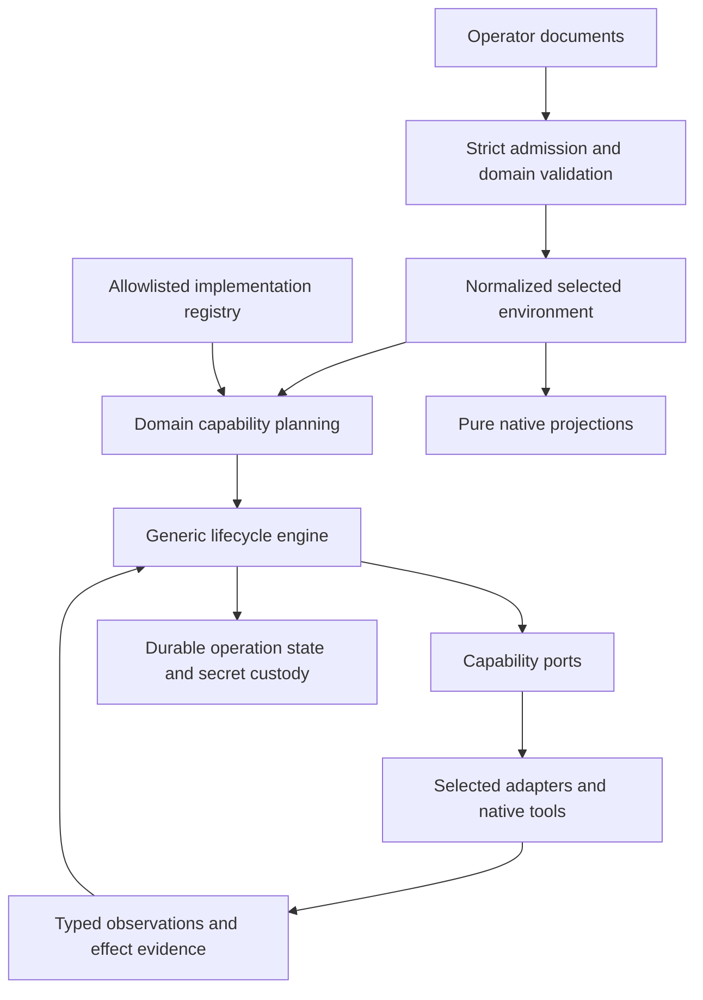

# Bootwright specification and agent-skill audit

Date: 2026-10-25. Scope: architecture, product contracts, specifications and agent guidance. Low- and medium-level implementation review is excluded. This report is the only requested repository change.

## Audit request prompt

Act as a principal platform architect, declarative API designer, reconciliation safety reviewer, and AI coding-agent workflow designer. Audit every repository specification and skill file, including deferred designs, coverage contracts, milestone definitions and history, skill references and tool-specific wrappers. Use repository evidence and current primary documentation for claims about external agent tools. Distinguish product requirements, implemented behavior, qualification evidence, future scope and recommendations; do not infer runtime correctness from prose or test names.

Evaluate whether Bootwright provides a coherent, intuitive and stable language for operators to declare desired platform state, and whether its architecture can materialize that language through generic orchestration and typed capability interfaces with isolated implementation/version adapters. Test the conceptual design against adding a new substrate, cluster distribution, storage implementation and infrastructure service without provider branches in shared policy. Assess the current requested product scope separately from already specified or delivered capabilities; do not silently discard existing contracts or treat the request as deployment authorization.

Review objectives, non-goals, domain boundaries, terminology, object identity, references, composition, ownership, defaults, validation, compatibility and extension semantics. Trace declaration through admission, compilation, observation, planning, authorization, execution, evidence, continuation, destruction and handoff. Evaluate every reconciliation rule family for security, safety and reliability, including partial failure, ambiguous observations, identity changes, stale plans, concurrent actors, secrets, irreversible effects and recovery. Define the appropriate responsibilities of Go, Ansible, Python and shell at architecture level.

Assess all repository skills and supporting agent instructions for correctness, discoverability, duplication, contradiction, procedural completeness and total accepted-task token cost. Propose explicit keep/modify/remove/add decisions, with a common semantic contract for Codex and Claude Code and minimal runtime-specific guidance. Optimize measured accepted outcomes rather than assuming shorter prose, cheaper models or more parallelism improve cost.

Produce an evidence-based report containing: an executive assessment of what is good, needs improvement and is bad; a complete per-file coverage ledger; prioritized findings with severity, evidence, consequence, recommendation and acceptance criteria; a concept and naming model; concrete desired-state API improvement proposals; a generic architecture and specialization contract; a reconciliation safety review; a language responsibility matrix; a skill portfolio proposal; and an ordered, bounded remediation roadmap. Include counterevidence and uncertainty. Label illustrative designs as proposals, not current APIs. Avoid unsupported guarantees or claims of optimality. Preserve local confidential information. Change no file except this report and do not commit, publish, deploy or execute platform operations.

Navigation: [assessment](#executive-assessment), [concepts](#concept-model-and-naming-recommendations), [API](#desired-state-api-recommended-direction), [architecture](#generic-architecture-and-code-materialization), [30 findings](#detailed-findings), [reconciliation rules](#reconciliation-rule-audit-and-required-invariants), [skills](#proposed-skill-portfolio), [roadmap](#ordered-remediation-roadmap), [file coverage](#complete-file-coverage-ledger).

## Executive assessment

**Keep the architectural foundation; correct the contradictory contracts before expanding the implementation portfolio.** Bootwright already specifies most of the right ingredients: declarative input, pure compilation, domain-owned policy, consumer-owned ports, controlled native adapters, immutable operations, explicit authorization, and evidence-based recovery. A wholesale rewrite or a larger collection of skills would be a poor first investment.

The specifications do **not yet provide a sufficiently consistent contract to claim safe generic expansion or an optimal operator API**. The most serious problem is a specified recovery path that can reinstall an already installed machine when its identity channel cannot answer after a power-off. Other contradictions concern unknown observations, durable formats, execution-runtime retention and supposedly read-only commands. Public schemas also expose current implementation assumptions, accept some intent that has no effect, and permit breaking changes without an API-version change. These are specification findings, not claims that this audit reproduced defects on hardware.

| Dimension | Assessment | Main action |
| --- | --- | --- |
| Product purpose and non-goals | Good, with scope drift | Keep bounded day-0 bootstrap; distinguish the immediate portfolio from expansion scope. |
| Domain ownership and dependency direction | Good | Preserve ports/adapters and one owner per invariant. |
| Generic orchestration and specialization | Good foundation, incomplete guarantee | Remove provider dispatch from consumers; qualify semantic substitutability. |
| Operator desired-state language | Needs significant improvement | Keep strict YAML; improve capability truthfulness, schema discovery, composition and compatibility. |
| Reconciliation safety | Strong principles, unacceptable contradictory rules | Resolve recovery, identity, observation and retention findings before extending destructive paths. |
| Reliability and recovery | Needs significant improvement | Make recovery dependencies durable and remedies executable, including capacity and unavailable-original-build cases. |
| Terminology | Mostly coherent, several overloaded terms | Establish a small normative vocabulary and consistent ownership/lifecycle terms. |
| Go/Ansible split | Good | Complete the Python/shell policy and separate native mechanism decisions from product policy. |
| Skills and agent entrypoints | Good small portfolio | Modify existing skills; remove conflicting instructions and unconditional gate repetition. |
| Token efficiency | Promising structure, not demonstrated | Measure accepted-task cost; shorten retrieval paths and repeated work before shortening safety contracts. |

**What is good:** strict decoding and provenance; no ambient executable plugins; separate secrets custody; positive physical identity proofs; explicit irreversible authorization; deterministic plans; separate apply/removal observations; owned-resource inverses; operator qualification distinguished from fake tests; four concise canonical skills with thin Claude wrappers.

**What needs improvement:** initial-scope clarity; common capability semantics across providers; public schema discoverability; lifecycle vocabulary; normative state tables; minimum recovery guarantees; explicit language ownership; concise current delivery indexes; effect-based verification; measured model routing.

**What is bad:** contradictory normative rules; destructive recovery based on missing evidence; silently ineffective desired-state fields; breaking grammar under an unchanged public version; instructions to delete requirements merely because tests exist; mandatory vendor-specific agent routing in shared guidance; and a dirty-worktree Stop hook that repeats broader checks regardless of the task.

No prose audit can guarantee the universally best API or optimal token consumption. Those are measurable product and workflow outcomes. This report specifies the experiments and acceptance criteria needed to establish them.

## Baseline, method and limits

The reviewed baseline is commit `77033e8f5e9e63f22d6aabae1359a5519ed588ed`, with a clean tracked worktree at the start. The inventory contains **50 specification files, 44,847 lines and 3,137,730 bytes**; **11 canonical skill/index/reference files, 703 lines and 40,968 bytes**; and **four Claude skill wrappers, 28 lines and 1,601 bytes**. Agent entrypoints, three Claude rules and Claude settings were also reviewed. File counts and bytes are measured repository facts, not token counts.

The prompt above was written first, then executed through parallel domain/API, reconciliation/security, and skill/governance reviews plus a coordinating architecture review. Findings were checked against their owning clauses and counterevidence. Source inspection was limited to public schema metadata, lifecycle interfaces and composition boundaries; no low- or medium-level implementation audit was performed. No platform operation or destructive test was run. Existing test names and acceptance records are references to evidence, not newly verified results.

The coverage ledger below names every spec and skill file. Current contracts were reviewed at their architectural and semantic boundaries. Large milestone/history files received systematic section, status, decision and full-text governance review, with relevant passages read in detail; their historical implementation claims were not individually re-proved. Knowledge pages and code were supporting evidence, not a claim of exhaustive code or knowledge-catalog review. Product-version statements quoted from repository material remain repository assertions unless explicitly sourced here.

Findings use **Critical** for a specified path to potentially destructive behavior without sufficient recovery knowledge; **High** for safety/reliability contradictions or a major obstacle to the requested stable generic design; and **Medium** for material usability, clarity or efficiency problems. “Confirmed” means the textual rule or contradiction is present. A gap or conditional risk is labeled as such. Priorities express recommended remediation order, not deployment authorization.

## Product scope and objective

[Project intent](../../../specs/project.md) correctly defines a bounded bootstrap orchestrator, not a continuous controller or arbitrary workflow engine. Keep that distinction. “Reconcile desired state” currently means realize one frozen environment, continue that exact operation, observe differences and remove recorded scope. It does not mean edit a running declaration and converge arbitrary day-2 changes. Repeating a completed apply does not refresh the target. These limits are intentional and should be visible in the first operator journey, alongside the cost of correcting input after registration.

The immediate portfolio requested for this audit is narrower than the current product and milestone portfolio:

| Area | Immediate requested focus | Specification implication |
| --- | --- | --- |
| Substrate | libvirt with sushy; bare metal with the selected xFusion BMC family; OpenShift Virtualization | Reuse common machine capabilities; qualify exact native behavior privately where appropriate. Specified KubeVirt support is not delivered support. |
| Storage | IBM Ceph; IBM Fusion Data Foundation integration | Keep the storage service contract separate from the cluster add-on consuming its export. |
| Infrastructure | Container-provisioned and external NTP/proxy; already provided networking | Distinguish external network dependencies from host/guest network configuration and explicitly owned bootstrap services. |
| Container platform | The current repository targets OpenShift/OKD; future distributions must fit the same architectural boundaries | The user's list does not explicitly settle a new container-distribution scope. Retain the current contract pending a scope decision; do not infer a managed cloud service implementation. |
| Wider portfolio | Additional substrates, cluster distributions, storage implementations and services | Require extension seams, not speculative implementations or vendor inventories in core specs. |

The current [project scope](../../../specs/project.md#product-scope) and M1–M4 also include broader provider, service and add-on work. The audit request changes no delivery state. A subsequent scope decision should classify each item as immediate, existing behavior to preserve, or future extension. It should not silently delete delivered capabilities. In particular, “already provided networking” needs a precise boundary: no provisioning of the external fabric, while declaring attachments, addresses, routes and required reachability remains necessary. Managed bootstrap DNS/artifact serving and post-install guest networking need an explicit placement in that boundary.

The right architectural objective is **a generic engine over cohesive capability contracts, with specialized adapters where native semantics differ**. It is not one universal object, one universal provider interface, or one workflow that pretends every platform has machines, BMCs and install media. A managed cluster API, for example, may fulfill a cluster capability without exposing a machine boot capability at all.

## Concept model and naming recommendations

Retain established public names unless a semantic ambiguity justifies a versioned change. Prefer a documented vocabulary over cosmetic renaming.

| Concept | Stable meaning and owner | Recommendation |
| --- | --- | --- |
| Environment | Selected desired-state graph; Environment domain | One root of selection, not an execution workspace or a cloud account. |
| Context | Durable local workspace; Workspace domain | Keep the CLI noun; always distinguish it from Go context and a bounded context. Give it an immutable incarnation identity separate from its name. |
| Controller | Host executing Bootwright; Controller domain | Use “management controller” or “BMC” for the target's out-of-band endpoint. |
| InfraProvider | Declared substrate instance and its configuration | Keep for compatibility; define “provider” as an instance, “implementation” as reviewed code, and “substrate” as the domain. |
| Machine | Logical target identity and capabilities | Separate existing physical identity, infrastructure ownership and OS management. `os.provided` does not express all three. |
| Realized target | Validated target handle and capabilities produced by substrate resolution | Avoid requiring a BMC representation when a native API supplies the capability. |
| Implementation | Deterministically selected reviewed implementation of a capability | Never an operator-supplied executable or filesystem plugin path. |
| Adapter | Translation/effect implementation behind a port | Do not interchange with provider, package, driver or lifecycle block. |
| Driver | If retained, an add-on execution adapter | Define it once; use adapter elsewhere. |
| Version specialization | A bounded native-mechanism difference inside an implementation | Not another lifecycle engine, release recommendation or permission exception. |
| Capability | A cohesive behavior with inputs, effects, results, failures and proof obligations | Disambiguate lifecycle capability, machine capability and add-on provided token in prose. |
| Desired / effective state | Authored intent / normalized selected intent | Neither is live state or evidence that an effect happened. |
| Observation | Timestamped, scoped evidence from a permitted read | Separate “unknown,” “absent,” “different,” “owned incomplete,” and “complete.” |
| Plan | Immutable intended actions and required authority | Not a promise that stale target observations remain true. |
| Operation / attempt / resolution | Durable lifecycle unit / bounded execution / evidence-based recovery observation | Keep all three; never use “run” when the distinction matters. |
| Block / stage | Capability work unit / coarse scheduling grouping | Blocks own effects; stages must not become provider-specific workflows. |
| Reservation | Coordination claim over a conflict identity | Does not establish ownership or grant destructive authority. |
| Ownership receipt | Durable proof linking a target incarnation to an operation | Names and labels are locators/assertions, not sufficient standalone proof. |
| Managed / external / provided | Responsibility choices | Define separately: who creates infrastructure, who installs OS, who observes readiness, who removes resources. Avoid using the three as synonyms. |
| Removal / retirement / erase | Remove owned effects / discharge a higher-level lifecycle under its stated resource fate / overwrite explicitly selected data | Retirement currently includes both retained add-on effects and deletion of backing virtual disks. Always name the actual fate; use relinquishment for retained unmanaged effects. |
| Supported / qualified / observed / admitted | Offered contract / passing acceptance evidence / an observed result / valid syntax | Never collapse into one “supported” boolean. Vendor support is a separate assertion. |
| Package / profile / binding / instance | Reusable definition / reusable selection or defaults / attachment to a target / realized lifecycle identity | Keep add-on namespaces distinct and explain why simple built-ins do not need authored package definitions. |

Two naming changes deserve investigation, not immediate renaming: `InfraProvider` is less clear than “substrate provider,” and the negative `os.provided` boolean hides infrastructure creation versus OS installation. Pilot clearer documentation and diagnostics first. If new explicit management modes are adopted, change the API deliberately and reject conflicting old/new forms rather than introducing precedence rules.

The bounded-context map should describe **Container cluster** and **Storage** in capability terms. Its current OpenShift/OKD and Ceph wording describes the first implementation families; it should not define the entire domain boundary. Keep native Ceph concepts explicitly named as Ceph concepts rather than implying that CRUSH, CephX or an OSD is universal storage vocabulary.

## Desired-state API: recommended direction

Keep the strict YAML document envelope and typed references. Familiar YAML plus generated editor schemas is a better starting point than a new DSL, expression language, templating engine or mandatory CUE/HCL layer. This is a recommendation based on Bootwright's existing investment and operator audience, not a universal language ranking. YAML's scalar and graph features need deliberate restriction; the repository already rejects ambiguous or hazardous constructs. The [YAML specification](https://yaml.org/spec/1.2.2/) defines the underlying data language, while Bootwright must continue documenting its smaller accepted grammar.

The `apiVersion`/`kind`/`metadata`/`spec` envelope is useful. Do not imply Kubernetes resource semantics merely because it resembles them: Bootwright has its own operation, identity and retention contracts. Kubernetes' separation of identity, desired state and reported state is a useful comparison, not a requirement to implement an API server. [Kubernetes API conventions](https://github.com/kubernetes/community/blob/main/contributors/devel/sig-architecture/api-conventions.md).

| Design question | Recommendation | Observable acceptance |
| --- | --- | --- |
| How does an operator start? | Provide a minimal complete path per supported outcome, then references/profiles for reuse. Preserve small examples alongside full environment examples. | A new operator can validate one machine, one cluster and one storage consumer without reading implementation histories. |
| How are fields discovered? | Export JSON Schema from existing schema metadata, supplemented by owning semantic rules; provide field explanations, defaults and runnable examples. Do not maintain a second handwritten schema authority. | Editor completion and CLI validation agree on closed fields, unions and required values; cross-object checks remain authoritative in Go. |
| How are defaults understood? | Explain each effective value's source: explicit input, profile, Environment default or derived relationship. Define omitted/empty/zero once per field class. | Operators can identify which source chose an endpoint, credential reference or network value. |
| What happens to unsupported intent? | Reject it before effectful registration, or explicitly classify it as declaration-only. A selected desired behavior may not silently disappear. | Every accepted effectful leaf has a consumer or a named refusal; supported-profile validation predicts plan eligibility. |
| How are implementation details expressed? | Keep common semantics outside a discriminated, implementation-owned schema. Native maps are bounded data, never a workflow or executable selector. | New implementation fields do not widen unrelated kinds or add provider switches to the engine. |
| What is the compatibility unit? | Public API version plus explicit internal request/evidence/format versions and executable capability metadata. | Previously accepted fixtures either preserve meaning or receive an intentional versioned refusal with a feasible recovery path. |
| How does composition work? | One authoritative reference/closure registry, explicit list semantics and collision errors; no directory order or hidden last-writer rules. | Transitive consumers retain all producers and prerequisites; diagnostics identify both conflicting declarations. |
| What can be observed? | Publish field-level realization and observation coverage, with unknown and unavailable distinct from equal. | A diff cannot imply that unobserved CPU, network, storage or service fields match. |
| How is destructive consequence shown? | Plans enumerate created, retained, retired and erased resources and residual credentials. | An operator can tell what remains after destroy without reading each adapter's spec. |

[JSON Schema 2020-12](https://json-schema.org/draft/2020-12) supplies standard schema vocabulary; choosing an export dialect does not outsource Bootwright's graph, ownership or authorization semantics to a schema validator.

An illustrative **future design shape**, not accepted Bootwright input, is:

```yaml
# Design sketch only; field names require an explicit API decision.
kind: InfraProvider
metadata:
  name: example-provider
spec:
  implementation:
    type: example-substrate
    config: {}  # Validated by that registered implementation's closed schema.
```

This sketch does not require replacing today's explicit union arms. Either representation is acceptable if schema dispatch belongs to a registered implementation, common semantics remain stable, unknown configuration fails closed, and the operator selects a semantic provider/type arm and configuration. Composition resolves and freezes the concrete implementation identity; operator input never selects executable code. Test both with real operator tasks before choosing. Do not replace a readable closed union with an untyped configuration bag merely to call it extensible.

API usability should be evaluated on representative journeys: initial declaration; malformed reference; omitted default; unsupported implementation; transient failure and exact continuation; changed input after registration; retained physical resources after destroy; and a secret/credential failure. Measure successful completion, correction count, time, explanation needed and mistaken assumptions. Include automation users checking structured output. A low number of YAML lines alone is not an intuitive API.

## Generic architecture and code materialization

The existing [architecture](../../../specs/architecture.md#dependency-direction-and-communication) already gives Go consumer-owned interfaces, immutable requests/results and composition-only binding. Keep those rules. The missing guarantee is that **all consumers depend on capability semantics rather than enumerating provider arms**, in Go and in Ansible composition alike.



**Engine ownership:** dependency graph, scheduling, effect admission, durable transitions, resource exclusion, cancellation, result classification and operator presentation contracts. **Domain ownership:** valid intent, prerequisites, target semantics, ownership, readiness, safe replay and inverse meaning. **Adapter ownership:** API/CLI/tool mechanics, native errors, bounded probes and proof acquisition. **Composition ownership:** exact bindings, immutable registries and implementation resolution. A generic engine may understand declared semantic properties such as “requires online cleanup”; it must not recognize an implementation name to infer them.

Each implementation contract should state: identity and contract revision; supported capability and operation set; input schema owner; pure planning constraints; target identity and scope; request/result/evidence schemas; required authority; owned and retained resources; completion and absence predicates; failure/effect-state separation; observation purpose; replay and deduplication; timeout/cancellation; prerequisite evidence; secret handling; execution dependencies; qualification evidence; and compatible continuation behavior. Most exist today in different places. Consolidate a short contract template and cross-links instead of duplicating every detail.

Use smaller domain ports where semantics differ. Machine realization, power, identity, boot-media delivery and disk selection are related but not interchangeable. A substrate that cannot prove an installation identity must not fake one. Cluster provisioning may use boot media or a managed service API. Storage can offer block, file or object capabilities without inventing equivalents for every Ceph-specific feature. Infrastructure services should share placement and lifecycle contracts while owning their own configuration and readiness criteria.

Ansible composition should bind fixed, reviewed role entrypoints to machine capabilities once. The consumer asks to prove identity or deliver media; it does not maintain a table of substrate names. This does not authorize dynamic task names from YAML. A compiled registry or generated fixed composition can preserve the existing allowlist boundary. Adding an implementation may legitimately add schema, adapter, composition, qualification and documentation; “low code impact” means shared policy and existing consumers remain unchanged, not zero edits anywhere.

| Extension exercise | Expected additions | Shared components that should remain unchanged |
| --- | --- | --- |
| New substrate | Typed provider schema/normalizer, machine capability adapters, composition registration, ownership/identity/media proofs, conformance and native qualification | Lifecycle transitions, managed-OS workflow, cluster installation policy, consumer provider-dispatch tables |
| New cluster implementation | Implementation-owned install/config schema, provisioning/readiness/access adapters, dependency declarations and qualification | Generic engine, substrate mechanics, unrelated cluster adapters |
| New storage implementation | Relevant storage capability schema and domain rules, native adapters, exports/consumer contracts and qualification | Generic engine, cluster provisioning, unrelated native storage object semantics |
| New infrastructure service | Service-specific configuration/readiness, selected adapter, registered placement/ownership contract | Operation engine and placement coordination rules |
| New native version | Artifact-fact detector and a bounded specialization at a declared seam, or a deliberate contract version if meaning changes | Workflow/authority/ownership rules when semantics are unchanged |

Add an architecture acceptance exercise using a small second or synthetic implementation of an existing port. It must implement all meaningful failure and recovery semantics, not simply compile. Verify substitution without type assertions, consumer imports or provider-name switches. Review changed-file impact rather than promising an arbitrary line-count limit. An implementation with incompatible semantics requires a new capability or a deliberate contract evolution.

Version specialization needs three distinct decisions: **artifact authenticity/integrity**, **capability applicability**, and **mechanical variant**. Unreadable or unauthenticated input must not masquerade as an ordinary nonmatching variant. Unknown feature evidence may use the general variant only when that variant conservatively proves its required preconditions before effects. Keep the existing prohibition on using specialization to weaken trust or ownership. Record the selected facts/variant for diagnosis without automatically changing intent identity; change the request/evidence identity whenever semantics or replay safety change.

## Language responsibility matrix

| Language/layer | Appropriate responsibility | Must not own |
| --- | --- | --- |
| Go domain/application | Desired-state meaning, validation, graph closure, implementation selection, plans, authority, lifecycle state, retry eligibility, durable recovery, public diagnostics | Vendor SDK calls or remote mechanics in pure policy; executable selection from operator strings |
| Go adapters | Workspace persistence, local privilege/runtime management, bounded local transformations, declared direct-access exceptions | Hidden policy or cross-domain orchestration outside the owning use case |
| Ansible playbooks/roles | Thin fixed entrypoints, placement, bounded observation/effects, native module composition, declared within-capability sequencing and cleanup | Cross-domain workflow, interpretation of new desired intent, operation state, granting authority or choosing arbitrary providers |
| Python modules/action plugins | Bounded protocol clients, native parsing/normalization, structured adapter results, native feature detection, narrowly scoped remote helpers | A second lifecycle engine, duplicated product defaults, independent authorization, unbounded command runners |
| Shell | Small pinned tooling launchers and necessary installer-native snippets; explicit arguments, strict bounds and failure propagation | Product state machines, reusable parsers, secret-bearing command strings, dynamic orchestration or provider selection |
| Templates/native documents | Deterministic projection of validated input | Expressions that read files/network/secrets or introduce execution authority |

The repository explains Go/Ansible well, but Python and shell need explicit criteria and examples. A network checkpoint's local protocol mechanics can live in a Python adapter; whether a failed checkpoint authorizes another installation belongs to Go's lifecycle/domain contract. A fixed Kickstart `%pre` guard may be necessary shell, but its identity requirements must be specified and verified by the owning domain. Prefer a standard module or native API when it preserves the contract; do not force complex parsing or branching into YAML to keep Python small. Conversely, do not move orchestration into Python merely because it is easier to express there.

## Detailed findings

The X findings below arise from the coordinating architectural review; R covers reconciliation/security, API covers declarations and domain contracts, and G covers skills/governance. Related findings are intentionally cross-linked rather than treated as independent runtime failures. Existing backlog IDs identify already acknowledged work; this report creates no new backlog items.

### X1 — High, confirmed: recovery can reinstall an already installed machine when identity is unavailable

**Evidence:** `specs/managed-os.md:563–569` explicitly equates a private installation that has powered off for a network restart with an installation that never began: private publication is gone, the machine is off, and the identity read cannot answer. It labels this positive no effect and says the next apply installs again. The interruption table at `:788` repeats the behavior. `specs/security.md:33–35` says ambiguous probes remain unknown.

**Consequence:** a transport/power-state ambiguity becomes permission to repeat a destructive installation. This is a specified replay hazard, not a reproduced hardware incident. The installed system's continued existence cannot be disproved by an unanswered identity channel.

**Counterevidence:** controller/installer target checks and physical data-loss authorization still apply (`managed-os.md:399–414`, `:1251–1284`). This is not evidence of a wrong-target wipe or a complete absence of operator authorization. Those safeguards nevertheless do not prove that reinstalling the same target is the safe continuation of its interrupted reboot.

**Recommendation:** record an acknowledged durable installation/network phase and intended disk boot before powering off. Once this operation has proved installation, recover by the qualified disk-boot/identity path, or remain unknown; never infer an uninstalled disk from unreachable SSH or a missing temporary publication. A preparation record alone must not claim completion that was never proved.

**Acceptance:** interrupt before/after installation proof, private-content withdrawal, power-off and disk boot on virtual and physical profiles. Repeating apply never invokes the installer after positive installation evidence unless a separately specified replacement operation authorizes it. Failed identity probes remain unknown. Preserve the existing exact-target and disk checks.

### X2 — Medium, confirmed: the substrate extension contract disagrees about where bindings change

**Evidence:** `specs/substrates.md:30–38` and `:975–980` require consumers to dispatch on frozen substrate arms and describe a per-entrypoint dispatch table. `specs/architecture.md:738–748` says implementation changes affect bindings, not consumers, then repeats consumer dispatch. B704 and B87/B99 in `specs/milestones/m1.md` promise new arms without consumer changes.

**Consequence:** an agent can implement either a central binding seam or new provider branches in every installer and still cite a specification. That prevents a reliable guarantee of low-impact extension.

**Counterevidence:** dispatch on a pre-bound capability token is compatible with ports/adapters. The defect is the ownership and extension obligation of the mapping, not the mere existence of dispatch. B704 already points toward the right abstraction.

**Recommendation:** define one composition/substrate-owned immutable mapping from implementation and operation to a fixed qualified entrypoint plus typed result contract. Consumers invoke semantic operations. Unknown or incomplete bindings refuse before publication or effects. No operator-authored role name or dynamic executable path is introduced.

**Acceptance:** add a synthetic substrate with identity, state, power and media operations by changing its adapter/schema/registration and qualification only; managed OS and cluster consumers require no provider-specific edit. Shared contract tests exercise failure, unknown, cancellation, replay and removal, not only successful method calls.

### X3 — Medium, confirmed gap: service responsiveness and useful service readiness need separate meanings

**Evidence:** `specs/infrastructure-services.md:540–549` accepts a server-mode NTP reply even if unsynchronized; `:520–521` deliberately avoids disciplining the host clock. Proxy readiness similarly proves a bounded protocol response. These are accurately specified transport-level checks.

**Consequence:** downstream readiness can be interpreted more strongly than the evidence supports. A time endpoint responding does not establish the time-quality requirement a consumer might need.

**Counterevidence:** an offline local time authority may be intentional. This audit does not establish incorrect clocks or require public upstream synchronization everywhere.

**Recommendation:** distinguish responding, configured local reference, upstream synchronized and unknown quality, with an explicit consumer-required level and bounded observations. Keep checks appropriate to the selected service purpose. Do the same for reachability versus authenticated/useful proxy service.

**Acceptance:** offline/local-reference and synchronized profiles report their actual quality; a consumer requiring synchronization cannot complete on responsiveness alone; missing upstream access is not silently converted into acceptable time quality.

### X4 — Medium, confirmed gap: lost-response ownership recovery needs an explicit remote-writer trust model

**Evidence:** `specs/add-ons.md:196–203` accepts a deterministic owner annotation plus creation timestamp when the creating UID receipt was lost, while acknowledging that only a recorded UID proves ownership outright. `specs/security.md:638–642` forbids adopting objects Bootwright did not create. Similar prepare/observe adoption patterns appear in storage.

**Consequence:** the annotation proves a matching assertion and the timestamp proves freshness; neither authenticates the creator against another authorized cluster writer. The recovery rule's safety depends on an unstated exclusivity/trust assumption.

**Counterevidence:** domain-separated object marks prevent accidental cross-object reuse; API-returned UIDs and exact desired-field comparisons are strong protections once captured. No exploit or hostile actor was demonstrated.

**Recommendation:** state and enforce the trusted-writer/exclusive-authority boundary, or require independently attributable native receipts/conditional operations and leave ambiguous lost-response creation unknown. A local pre-create journal records intent, not remote ownership, and is not sufficient alone.

**Acceptance:** concurrent matching-name creation, copied labels, lost create response, resource replacement and delayed observation produce either proved ownership or an explicit unknown/refusal. A replacement UID cannot inherit authority from the name or annotation.

### X5 — Medium, confirmed design concern: mechanical prose/comment reduction is not a quality metric

**Evidence:** `specs/architecture.md:215–260` allows essential rationale but imposes comment ceilings that only shrink and requires touching comments during review; `:992–1122` embeds substantial source-check implementation detail in the architecture contract. The architecture skill additionally says tested rules lose their prose (G4).

**Consequence:** monotonic line/byte constraints can reward moving necessary rationale away from the decision site, expanding knowledge retrieval, or making unrelated edits. A short prompt can cost more overall when an agent must reconstruct a missing invariant.

**Counterevidence:** banning narration, stale inventories and duplicated facts is valuable. Existing ceilings are deterministic and the knowledge catalog is searchable.

**Recommendation:** retain concise safety rationale where it is needed to understand the boundary; keep one normative owner and link its verification. Move detailed check implementation and historical exceptions out of the high-level architectural route. Use budgets as review signals, with reasoned exceptions and measured task outcomes, not a universal only-shrink objective.

**Acceptance:** an agent can recover a changed boundary's rationale and verification without opening unrelated knowledge/history; the same task produces no more omissions or rework after guidance reduction. Removing a comment is never necessary solely to offset a new essential safety explanation.

### X6 — High, conditional cross-contract risk: media cleanup authority is broader than media ownership

**Evidence:** `specs/container-clusters.md:905–935` specifies ejecting whatever media is currently presented, including foreign media. `specs/substrates.md:598–602` distinguishes a physical-machine claim from ownership and destructive authority. Cluster media ownership descriptions also differ between per-insert publication identity (`container-clusters.md:622–625`) and exact published scheme/host/path identity with port normalization (`:878–882`).

**Consequence:** after an external actor replaces the media, an inverse may affect something outside the original effect. Fresh machine identity proves which machine is addressed, not ownership of its current inserted image.

**Counterevidence:** the machine may be intentionally held under exclusive whole-device authority; clearing it can be necessary to complete teardown. The specs need to state that scope consistently. This audit has not demonstrated an implementation vulnerability.

**Recommendation:** choose and document exact owned-media cleanup or an explicit whole-device media-control authority with its exclusion assumptions and current-target proof. Unify logical media identity independently of per-attempt secret URL tokens. If byte integrity evidence is needed, retain it privately; the secret-bearing image must not gain a public content digest merely for convenience.

**Acceptance:** cleanup of own, absent, foreign and unknown media has one specified outcome; replacing media between proof and effect cannot silently widen authority; per-insert URL changes do not confuse ownership; retained trust settings and publications are reported accurately.


### Reconciliation, security and reliability findings

### R1 — High: name reuse and controller-local claims do not establish unique remote ownership

Evidence: `specs/contexts.md:11` makes the context name the only identity; `:16-23` explicitly allows reuse and admits undetectable replacement. `specs/state-reconciliation.md:1760-1761` explicitly says an abandoned same-name object's native identity reads as this context's. In contrast `:1821-1828` requires exact native identity and refusal of foreign/replacement targets. `specs/contexts.md:609-614` prescribes orphan deletion followed by the same init; `:815-822` releases claims while native objects remain. Host bindings are private to one root (`specs/contexts/controller-record.md:62-84`); no cross-controller authority exists in these files.

Consequence: the declared policy permits a new incarnation, or another controller using the same name, to confuse remote ownership; abandoned effects can encounter fresh mutation after a recommended recovery journey. The absence of cross-controller arbitration is not solved by a host-local mutex.

Counterevidence/uncertainty: exact ownership and positive absence are strong target invariants; physical overwrite receipts already use original apply identity (`state-reconciliation.md:1985-1988`); the deferred design explicitly depends on incarnation/lineage identity (`deferred/reconciliation-scenarios.md:80-84`). This is the known B568 design gap, not a newly reproduced exploit. Clone resistance is explicitly disclaimed (`controller.md:778-783`).

Recommendation: prioritize a random context incarnation and remote immutable object identifiers before broader reconciliation. Keep name as the operator handle; freeze an incarnation/lineage in claims, native markers, custody references, selections and removal evidence. State the supported single-controller authority boundary; require native conditional creation/UID checks or a shared fencing authority where multiple controllers can contend. Interim recovery text must require independently removing/proving absence of abandoned resources before recreating a name, never imply same init restores safe ownership.

Acceptance: delete/recreate same name; same name on two controllers; replaced native resource; lost local state; and repeated old-selection cases all refuse foreign effects. Native markers from one incarnation cannot authorize another. Destroy retains original lineage through replacement operations.

### R2 — High: recovery dependency retention follows recent setup history, not unfinished operations

Evidence: `specs/controller.md:810-817` promises continuation of an operation's frozen lock/ABI and says the registering build's runtime is kept. `:870-888` retains only current and immediately previous distinct runtime plus actively launched runtimes, then prunes wheel cache. An unfinished idle operation is not an active launch. `specs/contexts/controller-record.md:207-211` repeats this retention. `specs/controller.md:851-861` additionally discards all runtimes and cache for unreadable/foreign setup state yet says a future format change never strands a context. `state-reconciliation.md:1036-1045` requires preserving recovery dependencies without silent substitution.

Consequence: after upgrades A→B→C an idle A operation can lose its exact offline continuation closure; format healing can remove it immediately. A running/unknown removal cannot be replaced (`state-reconciliation.md:1547-1558`), so this can leave restoration or abandonment as the only exit.

Counterevidence: the previous runtime supports one upgrade; in-use lock prevents deleting a running adapter; cache-only rebuild can reconstruct a missing runtime only while all locked wheels remain (`controller.md:184-204`). Reacquisition may recover some cases, but neither availability nor the old setup reader's compatibility is guaranteed.

Recommendation: retain runtime and wheel closures reachable from every unfinished apply/removal, with current/previous as additional convenience retention. Format healing must preserve and prove referenced closures or refuse before deletion, with a precise recovery route. Remove the unconditional never-strands statement.

Acceptance: freeze unknown apply and unknown destroy under A, complete setup B then C offline, then invoke registering build A and prove or restore its matching setup/interpreter selection without deleting any referenced closure; continue each operation and inject interruption at cleanup and format transitions. Referenced runtime/wheels remain; unreferenced closures remain bounded and collectible.

### R3 — High: storage bounds can consume the capacity needed to resolve or destroy existing effects

Evidence: `specs/contexts.md:536-575` reserves first-pass entries and 16 MiB but expressly permits later attempts/logs to use the reserve and make destroy refuse registration or stop part way. `:595-616` offers orphan deletion and re-init once no destroy remains. `state-reconciliation.md:1199-1209` requires durable resolution identity/log before observation, and `:1289-1313` requires writable logs to recover. `security.md:695` describes crash/failure outcomes as recoverable while the contract admits abandonment.

Consequence: a bound intended to prevent resource exhaustion can strand an owned environment. Refusal is safe against immediate mutation, but the recovery journey trades away ownership, credentials and management.

Counterevidence: fresh-apply admission already reserves first-pass removal space; retained raw output cannot consume that reserve; bounds never authorize deleting evidence (`contexts.md:642-643`). The issue is exhaustion by mandatory records/logs and repeated attempts, not unlimited raw output.

Recommendation: reserve non-consumable emergency completion/removal capacity or define safe bounded journal compaction preserving current/source evidence. Prove admission for the entire recovery transaction, including finalization, logs and bindings. Treat exhausted attempt counters and keyring identity storage under the same liveness analysis. Do not advertise abandonment as ordinary capacity recovery.

Acceptance: fill storage to every admitted bound after repeated partial attempts; then resolve, remove and finalize without deleting ownership or old required evidence. Inject ENOSPC at each durable boundary and demonstrate a documented recoverable state. Distinguish physical filesystem exhaustion from internal admission limits.

### R4 — High: backup is repeatedly offered as a remedy without a supported restore contract

Evidence: `specs/contexts.md:354-371` says several damages are resolved only by restoring the whole store; `state-reconciliation.md:1504-1537` offers complete keyring backup restoration or orphan deletion; `specs/secrets.md:518-523` likewise requires backup for lost keys. Yet `specs/contexts.md:734-741` deliberately rejects copy restoration through device/inode binding, has no general restore/rollback command, and defers coherent rebinding and new encryption keys after counter rollback.

Consequence: an operator can possess a complete backup and still have no supported path to regain authority. Ad hoc restoration risks rejected identities or stale encryption counters; the alternative abandons remotely live state and confidential access.

Counterevidence: fail-closed inode binding and explicit anti-rollback requirements are appropriate; no unsafe automatic restore is promised. The defect is the missing executable recovery journey and misleadingly actionable remedies, not lack of a permissive bypass.

Recommendation: define a bounded, independently authorized complete-store recovery design: matching build, quiescence/fencing of old executor, coherent snapshot inventory, live lineage proof, exact filesystem rebinding, key rotation before new seals, and validation-only preview. Until delivered, qualify remedies as unavailable/qualified backup restoration rather than an ordinary repeatable command.

Acceptance: recover a complete backup onto fresh inodes, prove old controller cannot mutate, preserve all operation/custody relationships, and refuse partial/mixed snapshots and stale encryption counters without effect.

### R5 — High: removal observation text converts an unreadable target into no-effect

Evidence: `specs/state-reconciliation.md:545-548` says an observation unable to distinguish the removal postcondition from a target it could not read is read as no-effect so a retry proves absence. The immediately following table `:550-555` requires failed/forbidden/empty/malformed/contradictory observations to remain unknown; `:1228-1232` forbids retry while unknown; `specs/security.md:33-35` forbids treating ambiguous probes as absence.

Consequence: two implementers can legitimately derive incompatible retry authority: one blocks, the other maps an unreadable target to failed and admits a mutating inverse. Even if the inverse independently fails closed, this weakens the engine's proof boundary and its meaning of no-effect.

Counterevidence: every inverse must freshly prove ownership and positive absence; some capabilities legitimately cannot prove absence through one observation but can safely perform an idempotent removal. That requires a distinct typed replay-safe result, not positive no-effect evidence fabricated from unreadability. No runtime bypass established.

Recommendation: delete/narrow the exception. Unknown stays unknown unless a capability supplies positive, target-bound evidence for a safe retry state. If policy needs an observation-inconclusive-but-safe-convergence state, define it explicitly with prerequisites instead of overloading no-effect.

Acceptance: forbidden, disconnected, malformed and ambiguous removal observations never transition to failed/retry or register a replacement. Positive owned presence and positive absence retain their specified transitions.

### R6 — Medium: the read-only effect budget has contradictory owners

Evidence: `specs/controller.md:184-204` explicitly rebuilds/publishes missing runtime before diff and bounded runs; `specs/cli/commands.md:98` discloses that exception. `specs/state-reconciliation.md:297-306` says reads never create/repair/migrate and a bounded run creates at most output; `:1654-1657` says live comparison writes no record and runs no effect. `security.md:134-135` disallows cache/temp files for read-only commands; `:696` even asserts no process/network/secret lookup for all read-only commands, contradicting live diff and preflight by design.

Consequence: negative-proof requirements and operator expectations cannot be satisfied simultaneously; observation implicitly gains privileged repair authority and potentially waits on setup lock.

Counterevidence: cache-only rebuilding has no network, no package transaction, and verifies exact locked inputs. Catalog already declares it. It can be a deliberate product exception, but calling it store-internal does not erase its write/process effects.

Recommendation: define explicit authority classes (pure compile, local durable read, remote observe, runtime preparation, bounded effect, lifecycle effect) and one command effect matrix. Prefer an observation refusal with setup remedy if strict no-write semantics are intended; otherwise scope the exception everywhere and test exact permitted writes and locks.

Acceptance: test diff with missing runtime, missing wheel, held setup lock, cancellation and refused host; account for every process/file/secret read. No incidental cleanup or unrelated mutation occurs.

### R7 — High: current durable-format statements reject the format they say they publish

Evidence: `specs/contexts.md:186` says writes private format 5 and `:304` specifies registry version 5; `:192-205` says every version-5 registry refuses as the previous build's. `:189`, `:250`, `:304` say setup adds the Controller descriptor, while `specs/contexts/controller-record.md:28-35` and `specs/controller.md:785-789` say first apply binding creates it and setup writes no controller record.

Consequence: no conforming storage implementation can follow the full contract; operators and coding agents cannot infer the current durable format or first-publication authority. This is substantial drift in the owner of durable state, not a cosmetic typo.

Counterevidence: the no-conversion policy and predecessor refusal are explicit; actual implementation may use the correct new format. No code check was performed.

Recommendation: have one generated/read-verified durable-format inventory owned by Workspace; replace outdated declarations and link descriptor creation to its owner. Keep intended behavior separate from old migration history.

Acceptance: each documented format has one writer and one admission verdict; fixtures of current and predecessor records demonstrate acceptance/refusal, and setup versus first binding have distinct publication tests.

### R8 — Medium: readiness and inspection blur historical evidence, current access and actual owned inventory

Evidence: `state-reconciliation.md:35-40` correctly says settle proves records only, but `:1775-1812` calls a predicate over historical done evidence GitOps readiness/live access without requiring a fresh proof. `cli/output.md:505-508` labels historical endpoint evidence ready. `cli/commands.md:103` describes settled result as state already realized. `cli/output.md:673-675` derives status resource rows from selected declarations; `deferred/reconciliation-scenarios.md:167-173` explicitly acknowledges B578's missing declared/realized union. Orphan-delete guidance calls status the inventory (`contexts.md:749-751`).

Consequence: after drift or a selected-input update, ready can be read as live readiness and a deletion inventory can omit objects no longer declared. This undercuts informed destruction/abandonment and handoff.

Counterevidence: live diff explicitly reports unprojected/unknown fields, no repair is promised, machine power is separated from lifecycle state, and cluster access readiness explicitly disclaims live success (`cli/output.md:551-565`). These are good patterns to generalize. This is not a demand to turn day-0 apply into an unauthorized day-2 reconciler.

Recommendation: retain records-only settle but name temporal meaning consistently: recorded completion versus live observation. Add evidence source/observedAt and freshness requirements where a consumer needs current readiness. Inventory ownership from frozen apply/removal lineage union, then annotate desired membership. An observation snapshot is not a persistent authorization token.

Acceptance: delete a declaration while its effect remains; status and orphan confirmation still enumerate it. Restart/change a previously ready service; historical completion remains historical and no handoff claims live readiness without the required observation.

### R9 — Medium: universal fixed concurrency is contradicted by unbounded multi-SSH sessions

Evidence: `security.md:20-31` requires fixed target concurrency and process/resource bounds; `cli.md:1037-1040` says every selected SSH session starts concurrently with no bound. `cli.md:1109-1117` carries this into cluster exec. Power batches already use the engine bound (`:1324-1332`).

Consequence: a valid large selection can exhaust controller processes, descriptors or remote authentication capacity. Input cardinality is a finite ceiling, but not a qualified concurrency/resource budget.

Counterevidence: sessions are explicitly operator-owned streams, not lifecycle effects; argv/graph bounds limit the number eventually launched. They need not use lifecycle scheduling, but still need a documented resource policy or an explicit exception justified by qualification.

Recommendation: bounded session fan-out with deterministic admission and per-session stream ownership; preserve user-chosen remote command semantics. Document session-specific time/cancellation exceptions separately from managed automation.

Acceptance: selection at graph maximum respects process/descriptor budget; cancellation stops waiting admissions; per-target exit aggregation and output order semantics remain defined.

### R10 — Medium: duplicated lifecycle clauses already disagree on fault recovery and retries

Evidence: `state-reconciliation.md:1300-1306` says a settled verb never clears log fault; `:1810-1812` says settled apply restores it; `cli/output.md:679` offers that settled apply as remedy. `cli.md:558-562` describes one failed retry and all ready work deferred, whereas `state-reconciliation.md:897-906` and `cli/output.md:650-653` describe concurrent failed retries beside ready first attempts. `state-reconciliation.md:1259-1261` says superseding removal requires target restored to apply exactness, while `:576-588` explicitly permits removal's own ownership check for drifted targets.

Consequence: operator remedies, previews and safety tests can encode different transition policies while every paragraph looks authoritative.

Counterevidence: one transition-table test and shared decision-path goal exist (`state-reconciliation.md:493-495`, `:975-1008`); the richer newer rules are clear. Test names and golden matching cannot prove every prose statement agrees.

Recommendation: make the canonical transition/effect classifier the sole normative owner; CLI states only projection and references it. Move historical explanations into decisions. Resolve these three contradictions explicitly, then generate or mechanically compare all preview/next-step projections against that classifier.

Acceptance: one table drives plan, status, effect admission and remedy for every state/verb/fault combination, including all-done+fault, several failed siblings, and drifted-owned removal.

### Desired-state and domain findings

### API-01 — High: several simultaneously authoritative pages disagree about what executes

Evidence: `specs/api/storage.md:3–7` assigns admission authority to itself and native/resource pages; `:15–18` says NVMe gateway planning always refuses and `:90–92` says no subsystem capability exists. `specs/storage.md:1493–1534` instead describes an implemented gateway/subsystem lifecycle, frozen request move and supported whole-cluster retirement. `specs/storage-native-api.md:957–989` and `specs/storage-resources.md:18–19` likewise describe realization. `specs/storage-api-review.md:15–19,227–269` describes many now-realized resources as target-only; `specs/storage-resources.md:1492–1493` contradicts its own current opening. `specs/deferred/storage-api.md:182–184` has an IBM erasure-code pair restriction that `specs/api/storage.md:369–370` explicitly does not impose.

Impact: operators, reviewers and implementation agents cannot derive one accepted intent/plan/refusal contract. This is more consequential than cosmetic stale prose because the alternatives change effects and refusal guarantees.

Counterevidence: milestones and detailed implementation sections carefully distinguish delivery from live qualification; historical design records are useful and should remain available.

Recommendation: retain history with an explicit immutable as-of status, remove its present-tense authority, and maintain one canonical per-capability admission/planning/execution/removal/qualification inventory. Generate or mechanically check the current status summaries against it.

Acceptance: every admitted kind and service has one unambiguous current execution/removal verdict; NVMe and replication statements agree; historical restrictions cannot masquerade as current admission rules; a link check alone is insufficient.

### API-02 — High: explicit Environment selection has an incomplete storage closure

Evidence: `specs/api/environment.md:198–218` calls its closure authoritative. Its direct StorageCluster row (`:204`) includes many child kinds but omits StorageClient, StorageObjectUser, StorageObjectBucket and StorageReplication, all admitted/realized elsewhere (`specs/api/storage.md:61–81`; `specs/storage-resources.md:9–19,238–279`). Omission of both lists bypasses filtering entirely (`environment.md:217–218`). `environment.md:240–241` still calls the catalog 27 kinds, versus `specs/api.md:262–275`'s expanded catalog.

Impact: selecting the same otherwise complete cluster can remove access or replication intent, or leave reference retention unspecified. Cross-cluster replication needs an explicit rule for both roots, without accidentally broadening export-only dependency selection.

Counterevidence: the existing closure deliberately distinguishes explicit roots from export-only roots and iterates to a fixed point. This is a sound mechanism worth retaining.

Recommendation: give each registered kind a selection/dependency role and define directional replication and resource dependency closure centrally. Derive exhaustive catalog/closure checks from that registry.

Acceptance: explicit versus unfiltered equivalent root selection preserves all intended children; selected buckets retain their owner and gateway; selected replication retains its necessary endpoint chains; export-only roots still exclude unrelated children; every catalog kind has a tested closure policy.

### API-03 — High: accepted fields and unusable defaults weaken desired-state meaning

Evidence: `specs/container-clusters.md:54–66` and `specs/api/container-clusters.md:193–197` admit endpoint DNS/port/scheme/prefix/interface-network and node-label/taint intent that is preserved without the declared deployment effect. The api-int DNS name does participate in named-certificate collision validation; that does not realize the requested DNS name. `specs/api/storage.md:205–206` defaults transport to native; `specs/storage-coverage.md:37–42` says native remains refused. `specs/api/custom-playbooks.md:23,30–34` defaults enabled true while enabled playbooks refuse planning. `specs/api/environment.md:454–455` deliberately separates admission from execution support.

Impact: a valid declarative document can assert operational properties that never become a planned effect. A default that predictably refuses makes the first successful journey require knowledge outside the schema.

Counterevidence: `specs/api.md:23–29` explicitly says compiler validity is not executable support, and plan-time refusal occurs before registration. Future schema admission is deliberate; this is not a claim that validation currently promises execution.

Recommendation: keep pure validation, but expose capability classification consistently and prevent ignored effect-bearing fields from looking realized. Either give inert fields a complete implementation contract or explicitly refuse their use in executable planning. Reconsider always-refused defaults through the schema decision process; provide a minimal executable example with all necessary choices.

Acceptance: every admitted field is classified as realized, inspection-only or explicitly unsupported; authored unsupported operational intent gives a precise pre-effect diagnostic; the documented minimum Ceph example chooses a usable transport; compiler validity and execution readiness are visibly distinct in both human and machine results.

### API-04 — High: interrupted Ceph deployment remains outside the general continuation promise

Evidence: `specs/storage.md:656–662` explicitly refuses partial-cluster recovery after a non-bootstrap host carries a daemon while the cluster is not ready, pending B659. `:687–689` separately describes a partial DB/WAL boundary. Broader recovery language at `:1355–1360` and `specs/storage-resources.md:1462–1477` expects exact journaled continuation. This gap occurs after durable/native effects in the primary multi-host journey.

Impact: the requested physical Ceph product profile can enter a state with safe refusal but no declared forward recovery. Whole-VM retirement is a fallback for virtual environments, not an equivalent physical recovery strategy.

Counterevidence: readiness timeouts can continue after native convergence (`storage.md:650–654`); the spec honestly labels the gap and refusing is safer than replaying uncertain effects.

Recommendation: make completion of the initial qualified Ceph journey depend on interruption coverage at enrollment/device/OSD/service boundaries, or describe it as an explicitly incomplete recovery profile. Add journaled transitions preserving original device identity and custody; never weaken the existing refusal merely to obtain liveness.

Acceptance: fault injection immediately before/after every relevant effect proves deterministic continuation, explicit recoverable unknown, or a documented safe terminal recovery; physical and virtual profiles have separately evidenced outcomes.

### API-05 — High: schema/runtime compatibility requires an explicit operational survival contract

Evidence: `specs/api.md:31–37` keeps breaking changes in v1alpha1 unless the user requests a bump, and `:109–110` rejects aliases/conversions. `specs/api/storage.md:213–220`, `specs/storage.md:1533–1534` and `specs/container-cluster-coverage.md:181–183` require finishing or destroying old operations with their original build after format changes. `specs/storage-native-api.md:918–926` also describes same-version breaking input migration.

Impact: apiVersion cannot identify the grammar an authored document needs, and upgrading a CLI can make the only recovery/destruction path depend on an executable and dependency closure the operator may not have retained.

Counterevidence: alpha status and explicit migration are intentional; frozen bindings and refusing reinterpretation are correct safety mechanisms. This finding does not authorize changing the requested version policy.

Recommendation: seek an explicit decision to version incompatible public grammar. While the current alpha policy remains, identify the accepted schema/reader revision independently and retain/discover the exact original executable and execution closure; a fingerprint supports diagnosis but does not replace a public compatibility policy. Separate input migration, completed-state inspection and unfinished-operation continuation guarantees.

Acceptance: a saved document identifies its accepted grammar; before upgrade the operator can determine which contexts require the old build; an interrupted operation can reliably locate/reconstruct its retained trusted execution closure; incompatible builds fail with actionable provenance rather than only a format version.

### API-06 — High architectural decision: distinguish operator version choice from native prerequisites and qualification

Evidence: `specs/architecture.md:938–941` forbids component compatibility rules, immediately followed by immutable supported-target/version constraints and domain matrices (`:943–955`). `specs/storage-coverage.md:27–35` appropriately calls tested rows evidence rather than approved versions. Yet native document admission still embeds release assertions, for example `specs/storage-native-api.md:373–374,569–570`, while arbitrary operator versions are accepted (`specs/api/storage.md:109–122`). Container topology/network rules are generalized from named release references (`specs/api/container-clusters.md:226–235,450–465`). These are repository assertions, not externally validated vendor guarantees.

Impact: eliminating compatibility allowlists must not eliminate an adapter's executable preconditions or let successful acquisition look like proven deployment support. Conversely, hard-coded historical native shapes in a generic API can reject valid newer provider intent or defer predictable incompatibility until effects.

Counterevidence: artifact-based specialization with disjoint seams and unchanged safety checks (`architecture.md:925–936`) is a strong design. Native readiness and operator acceptance are explicitly separated in storage.

Recommendation: define four independent concepts: chosen artifact identity; observed native capabilities/preconditions; Bootwright exercised lifecycle evidence; vendor support (only when sourced). Keep a general adapter and narrow feature-detected specializations, but allow the adapter to state/refuse unmet required capabilities without introducing a product pairing allowlist. Put provider/version-specific schema and evidence in domain-owned modules behind shared lifecycle interfaces.

Acceptance: arbitrary authored versions remain authorable; planning/proof diagnostics distinguish unrecognized from unsupported native prerequisite and unqualified from failed; native-shape differences are tested at the proper adapter seam; no vendor support claim is inferred from Bootwright tests.

### API-07 — Medium: public names inherit hidden runtime length constraints

Evidence: `specs/api/machines.md:26–30,176–180` imposes name limits because of generated runtime identifiers; `specs/api/infrastructure-services.md:27–38` changes limits between managed/external forms. `specs/storage.md:244,274,283,289` and `specs/storage-native-api.md:515–518` shorten allowed cluster names depending on selected services. `specs/storage-resources.md:203,1365` similarly limits gateway/bucket names. The NVMe runtime already uses a bounded hash token (`storage.md:1495–1498`).

Impact: a valid immutable user name can make adding a capability impossible, coupling conceptual identity to adapter implementation details. This encourages disruptive rename/recreate migrations for unrelated feature additions.

Counterevidence: limits are deterministic and fail early, and native names sometimes genuinely require narrower grammar.

Recommendation: separate authored logical identity, native identity where necessary, and internal bounded block identity. Use a stable collision-resistant encoding for internal names; preserve existing ownership IDs and make any migration explicit.

Acceptance: a previously valid logical name remains usable across supported service combinations; collision behavior is tested; native-name restrictions remain accurately documented; no existing operation changes identity silently.

### API-08 — High: initial focus needs a complete cross-domain profile, not a union of admitted features

Evidence: managed/external NTP/proxy have a clear ownership model, but managed OS proxy accepts only external (`specs/api/machines.md:470,641–642`), and container installation proxy is currently refused (`specs/container-clusters.md:97`). Managed services require already-provided placement OS (`specs/api/infrastructure-services.md:47–50`), so not every managed proxy use creates a bootstrap cycle. FDF exports intentionally expose broad cluster authority (`specs/storage-resources.md:1200–1205`) and retirement with surviving physical hosts remains refused (`:1172,1252–1255`; `specs/storage.md:1475–1482`). The broad schema includes multiple providers/distributions and advanced storage families beyond the requested initial journey.

Impact: separately delivered components do not establish one intuitive, recoverable physical/virtual cluster + storage + FDF + infrastructure-services product journey. Generic exported-resource wording can conceal the breadth of the actual FDF trust grant.

Counterevidence: the specs are explicit about broad export trust and pending online teardown. Many additional features are already delivered; removing them is neither necessary nor recommended.

Recommendation: publish a bounded initial product profile and readiness DAG: libvirt+sushy, physical/xFusion, OpenShift Virtualization, IBM Ceph, IBM FDF, existing networking and the supported managed/external service placements. Distinguish controller bootstrap routes, guest runtime routes and cluster routes; permit managed references only with proved acyclic readiness and qualified transport. Make FDF's actual grant scope visible in planning. Track independent physical revocation/removal as a profile completion criterion or explicit limitation.

Acceptance: one minimal complete example per requested substrate; cross-domain preflight reports exact unavailable edges; no false cycle refusal for an already-ready service; physical removal and FDF grant scope are accurately represented; optional delivered capabilities remain available.

### Skill and governance findings

### G1 — Medium: the canonical workflow embeds vendor-specific, unmeasured routing as mandatory policy

Evidence: `.agents/skills/code-implementation/references/agent-operation.md:26–43` prescribes default effort, says changing effort invalidates prompt cache, requires explicit models for every worker, and says the orchestrator runs on Opus. Lines 45–64 prescribe model tiers, many Sonnet workers, exact implementer briefs and stronger-voter arbitration. Lines 66–91 separately mark the OpenAI mapping unqualified. `specs/milestones/m4.md:123`, `:565–568`, `:1811` also put model routing into delivery-state content.

Impact: a supposedly shared procedure cannot be applied literally in a runtime that lacks those models or inherits model settings by design. Detailed handoffs, extra voters, and parallel workers may consume more total tokens than one capable worker; the guidance offers no repository measurements that establish the prescribed staffing as better. A stronger model's opinion is evidence to investigate, not a deciding vote on a defect.

Counterevidence: lines 9–22 correctly require acceptance criteria, total accepted-task cost and live capability checks. The OpenAI rows explicitly avoid claiming equivalence. Existing historical routing decisions explain the current text but do not establish present portable support.

Recommendation: keep model-neutral criteria in canonical procedure; move actual runtime configuration/examples into short optional Codex and Claude references, loaded only when routing is authorized and useful. Replace model voting with an evidence/reproduction rubric. Remove unsupported universal cache claims after official-document review; do not infer runtime behavior from API behavior. The runtime-specific recommendations below cite current primary documentation.

Acceptance: the same read-only audit, prose edit, bounded fix and security change route correctly in Codex and Claude without nonexistent-model requests, mandatory delegation or edits to milestone prose; explicit authorization/host capabilities win. A small representative benchmark records quality, retries, review effort and total tokens/cost before changing defaults.

### G2 — Medium: Claude's dirty-tree Stop hook undermines the declared inner loop and makes unrelated work expensive

Evidence: `.claude/settings.json:41–50` executes `git diff --quiet HEAD -- ... && test -z "$(git ls-files --others --exclude-standard)" || make quick >&2` at Stop, with a 300-second timeout. `.agents/skills/code-implementation/references/verification.md:7–19` says focus is the intermediate tier, with measured spec focus ~4 seconds versus quick ~60 seconds; `.claude/rules/guidance.md:8` requires docs-check for guidance. The allowlist `.claude/settings.json:4–17` includes quick/docs-check but omits focus/check/race.

Impact: any tracked dirty change or untracked nonignored file, including pre-existing unrelated work during a read-only task, runs the broader quick tier. Repeated stops rerun it without content-change caching. This is a confirmed configuration behavior, not a measured estimate of incurred session cost. Missing allow entries do not prove commands are blocked: other permissions/runtime defaults may decide them.

Recommendation: remove the unconditional expensive Stop hook or make it report task-specific verification state; if a check hook is retained, select the authorized task's change class and cache successful results by checked content/config identity. Never reinterpret a dirty worktree as permission to fix it. Align safe command permissions with the intended pinned verification workflow after runtime-specific validation.

Acceptance: a read-only review over an unrelated dirty tree executes no gate; a guidance-only edit runs docs-check/focus once per relevant change; a safety change still requires its declared full gate and independent review before integration; repeated unchanged Stop events add no gate cost. Verify Claude hook exit-status semantics in current official docs rather than assuming this command enforces completion.

### G3 — Medium: verification is mostly temporal/path-based, not a complete change-class contract

Evidence: `code-implementation/SKILL.md:32–37` mandates `make check` for the integrating commit and defines safety by an enumerated set of component paths that omits Secrets, Trust, Controller privilege and add-on effects. `references/verification.md:23–25` says a probe that never failed proves nothing. `references/go.md:84–86` independently expands race requirements by concurrency semantics; `security-safety/SKILL.md:38–45` has the broader effect-based review criteria. `references/verification.md:53–56` admits parallel-only failures can be reported passing after serial reruns and that a deadlocked worker has no timeout.

Impact: readers can interpret the safety list as exhaustive and miss independent review for security-sensitive changes outside it. Documentation, formatting, new-feature and behavioral-defect tasks have different meaningful probes; universal red-before-green is not a truthful proof rule. Runtime fixtures and failures must not disappear into a green serial rerun. The text already describes limitations honestly, so this is a procedure-design defect, not a newly proven test-runner failure.

Recommendation: one verification matrix selected by changed contracts/effects: editorial links; schema/CLI contract; behavior defect; adapter/qualification; trust/durability/concurrency; dependencies/toolchain. Specify minimum gates, conditional escalation, independent review and evidence outputs. Retain the current full-integration gate until a separately authorized measured change establishes safe class-specific exceptions. Require a failing regression for an existing bug when reproducible, and suitable positive/negative checks for other changes. Mark flaky parallel outcomes separately and define bounded check execution.

Acceptance: example changes to secret handling, publisher trust, privilege handoff and add-on ownership select security review even outside the named paths; editorial changes do not require invented failing regressions; unrun/flaky/serial-recovered outcomes remain distinguishable; a stalled test ends with a truthful unavailable/failed result.

### G4 — Medium: 'an executable rule's prose goes' confuses normative authority with its verification

Evidence: `architecture-best-practices/SKILL.md:16–23` first says specs own requirements, then says 'A rule a tool can check becomes a test, and its prose goes.' AGENTS.md:14–16 assigns required behavior to specs. UX skill:34–37 requires specs/examples and tests to change together.

Impact: an agent can delete an externally meaningful safety, compatibility or API requirement once a test checks it; users and future reviewers then have no normative statement to evaluate the test against. Tests are evidence of some behavior, not replacements for the contract or proof of every input.

Recommendation: remove redundant inventories and mechanical recipe duplication; retain concise normative invariants with owning test links. Change the rule to distinguish requirements, executable inventories and rationale.

Acceptance: every public/safety invariant has a stable owning contract even when tested, while generated inventories have a single executable source and drift check. No guideline directs deleting semantics solely because a test exists.

### G5 — Medium: scope discipline needs explicit delivery modes and a definition of inseparable repairs

Evidence: AGENTS.md:18–26 and `code-implementation/SKILL.md:13–20` require backlog registration, isolated worktree and no same-change pre-existing defect fix; lines 42–51 presume commits/integration. `specs/milestones.md:39–64` correctly says only prompt authorization permits implementation, and every new discovery otherwise creates a milestone item. B665 (`specs/milestones/backlog.md:2225–2240`) already proposes a user-request reference form, but the skill has no such form today.

Impact: read-only/report-only/no-commit requests conflict operationally with automatic backlog/worktree/commit procedure unless the agent explicitly applies user precedence. A blanket prohibition on pre-existing repairs can also exclude a minimum prerequisite required to meet the authorized outcome. This audit's explicit single-file/no-commit instruction controls; no routine delivery mutations were performed.

Recommendation: add short mode selection: review-only, edit-without-integration, normal delivery. Record follow-ups in the requested output when extra tracked files are excluded. Define an inseparable prerequisite test (necessary to acceptance, smallest possible change, disclosed) versus independent scope expansion; otherwise report the blocker. Keep isolation for ordinary delivery and preserve unrelated work.

Acceptance: a report-only request changes only its report and creates no branch/backlog/commit; a no-commit code request can still be fully tested and handed off; independent defects remain follow-ups; necessary prerequisite repairs do not create arbitrary workflow deadlocks.

### G6 — Medium: milestone/history retrieval is expensive and current-state semantics rely on narrative exception resolution

Evidence: assigned milestone content is 19,522 lines, including 8,329 delivered-history lines and 4,056 backlog lines. `specs/milestones.md:7–9` routes readers into those files, `:107–119` uses global max-ID discovery and renumbering, and `:39–64` defines WIP/Requires/promotion rules. M2/M3/M4 carry extensive exception decisions, partial delivery and owner acceptance independently. M5 and M6 are retired yet their status stays `not started` (`m5.md:5–9`, `m6.md:8–12`), a documented exception rather than ordinary not-started work. All decision links mostly target the whole Decisions section.

Impact: a bounded task can require expensive provenance reconstruction; statuses such as proposed/accepted definition, in-tree implemented, operator-accepted and historical completion cannot safely collapse into a single delivered boolean. Narrative exceptions weaken simple WIP and state validation. This is not a claim that any recorded waiver is unauthorized: many explicitly cite owner requests.

Recommendation: preserve history but build a compact current index over stable B/X/D IDs with direct anchors and explicit separate definition/implementation/qualification/acceptance states, applicable prerequisites, supersession and waivers. Split historical records by stable slice/decision or generate an index; do not bulk-load them. Store implementation detail in its contract once and link from delivery records. Avoid gratuitous renumbering or history rewrites.

Acceptance: given any active B/X ID, an agent retrieves its current bounded outcome, unmet gates and owning contracts without reading unrelated history; a checker detects dangling IDs, contradictory active status and missing acceptance references; retired milestones are distinguishable in machine data; cost measurements show reduced retrieved tokens without missed constraints.

## Reconciliation rule audit and required invariants

The rule-family review covers admission through handoff and removal. “Good” below means the specification contains a useful protection; it does not certify its implementation or live qualification. The appropriate target is safe convergence or an actionable, bounded refusal, with recovery dependencies preserved. It is not “never fail” or automatic rollback of irreversible native actions.

| Rule family / interaction | What is good | Required clarification or improvement |
| --- | --- | --- |
| Discovery, decoding and selection | Strict bounded input, provenance, duplicate refusal and fixed-point graph closure | Complete the selection policy for every kind (API-02); keep declaration-only content distinct. |
| Authored → effective → frozen | Pure normalization and immutable operation requests | Define byte identity, semantic identity and live equivalence separately; stabilize schema identity (API-05). |
| Implementation selection | Allowlisted exact-one resolution, no ambient plugins/latest fallback | Separate semantic provider choice from concrete binding; resolve X2 and API-06. |
| Plan → authorization → effect | Explicit token union; confirmation does not prove target or ownership | Re-prove mutable preconditions immediately before effects; never use missing evidence to authorize another install (X1). |
| Unknown → observation → retry | Unknown blocks are resolved before other work, with durable resolution evidence | Unreadable stays unknown; remove the no-effect exception or specify a separate positively justified replay state (R5). |
| Ownership → identity → inverse | Native IDs, original-operation evidence, positive absence | Add incarnation identity; define foreign-writer assumptions and media authority (R1, X4, X6). |
| Reservations and concurrent actors | Root coordination and per-context leases; resource claims before effects | Claims are host-local, SSH placement is not coordinated across contexts, and two controller roots do not share authority. State and enforce that operating boundary. |
| Stale plan and lock upgrade | Re-proof under exclusive lock; immutable request comparisons | Keep native conditional operations and residual race analysis; a local lock does not fence external writers. |
| Partial effects and interruption | Attempt-before-effect and prepared acknowledgements; per-capability observations | Close the installed-before-poweroff ambiguity and Ceph multi-host partial-recovery gap (X1, API-04). |
| Finalization, logging and custody | Produced material captured before done; withdrawal after removal | Reconcile settled log-fault rules; jointly qualify store/log/custody crashes (R10). |
| Storage and attempt bounds | Finite records, bytes and raw-output truncation | Reserve non-consumable recovery capacity or safe compaction; account for serialization overhead and all final writes (R3). |
| Dependency retention and build changes | Frozen ABI/lock and explicit semantic content identity | Retain every reachable recovery closure and its trusted reader/build, including idle operations (R2, API-05). |
| Credential binding and revocation | Immutable secret versions, confidential handles, no secrets in request identity | Revoked credentials can strand continuation. Specify this limitation; future rebind requires separate authority and proof, never implicit latest-secret substitution. |
| Backup and disaster recovery | Fail-closed filesystem identity and anti-rollback intent | Backup remedies need a supported coherent restore/rebinding/key policy (R4). |
| Apply done versus current state | Settled apply deliberately uses records, live diff does not repair | Label historical completion and live observation with evidence source/time/coverage (R8). |
| Observation effects | Read-only domain ports and explicit bounded probes | Publish one effect-class matrix for pure compile, durable read, remote observe, local preparation and mutation (R6). |
| Destruction and dependency reversal | Reverse graph, online cleanup and pre-stop phases, quiescence checks | Every inverse must state retained resources and surviving consumers; foreign media and remote claims need clear authority. |
| Physical installation and erase | System/MAC/disk checks, private publication, explicit data-loss tokens and acknowledged erase receipts | Preserve residual-race honesty and actual hardware qualification. Device-path admission is not universal immutable disk identity; safe stronger selectors need a defined proof contract. |
| Managed services | Explicit placement, listener claims, owned paths and bounded readiness | Prove meaningful readiness, not only response; account for remote-host sharing and documented socket-release gaps (X3). |
| Add-ons and external grants | Closed object program, exact initial approvals, secret placement and per-object evidence | Retirement leaves effects/credentials on retained physical clusters; expose residual scope and revocation obligations. FDF's export authority must be visible (API-08). |
| Bootstrap and GitOps handoff | GitOps does not acquire Bootwright ownership; downstream scope must exclude owned resources | Define freshness at handoff and per-cluster versus whole-environment completion; do not imply continuous readiness. |
| Cancellation and remote work | Bounded runners, unknown outcomes and descendant supervision requirements | Native work may outlive local cancellation; preserve durable evidence and locks. Documented unclosed descendant cases remain qualification limits. |
| Operator access sessions | Explicit target selection, pinned access and separate session semantics | Bound fan-out and resource use; interactive time limits may differ from managed jobs, but exceptions must be explicit (R9). |
| Future delta/replacement | Separate deferred design, lineage and explicit authorization | Require current parent identity/readiness at the effect boundary, carried evidence/custody reachability and complete owned inventory before promotion. |

The central observation model should be small and explicit:

| Observation | What it proves | Permitted interpretation |
| --- | --- | --- |
| Complete | Exact target, required postcondition and relevant ownership | Record done after required material/evidence publication. |
| Absent / no effect | Positive evidence of absence or a proved pre-effect state, for this operation's verb | Retry only under that capability's safe replay contract. |
| Owned incomplete | Exact owned target and identifiable partial work | Resume the bounded convergence path. |
| Foreign / replaced | Another incarnation, owner or unexpected immutable identity | Refuse; never adopt or erase by name. |
| Unknown | Unreachable, forbidden, incomplete, malformed or contradictory evidence | Preserve uncertainty; do not infer absence or grant additional effects. |

Keep operation status, attempt outcome and observed effect state separate. “Failed” can coexist with an unknown effect; a process failure is not proof that nothing changed. A safe idempotent API request may sometimes be repeated despite an inconclusive observation, but that needs a separately proved replay contract and must never be represented as positive evidence that no effect occurred.

Additional contract corrections belong with the findings, rather than new feature work:

- `specs/state-reconciliation.md:758–769` anticipates total request bytes up to 4 MiB while `:420–423` bounds the complete plan record at 1 MiB; B715 marks future larger planning bounds. Prove aggregate encoded-size fit before promoting them.
- `specs/contexts.md:373–382` deliberately holds broad root locking across operations, limiting concurrent status and contexts. Narrowing it is future work; preserve atomic reservation and authority checks if changed.
- `specs/security.md:225–264` describes descendant/process-lock limitations. A cancellation claim must state what has actually stopped and what remains unknown.
- Secret-info selection and disclosure wording disagree: `specs/secrets.md:134–136` permits an empty unknown selection, while CLI clauses refuse it; `specs/cli/output.md:525–527` calls the dashboard field the only sensitive field although object-user outputs also carry secrets. Use one typed output/disclosure catalog.
- Deferred reconciliation requires live identity/readiness before new effects on an existing parent, even if its scenario text treats an earlier observation as optional. A prior `diff` is not an authorization token.

## Proposed skill portfolio

**Keep four canonical skills now.** Their scopes are sensible and their bodies are already short. Most waste comes from contradictory procedure, repeated verification and long retrieval chains, not the number of skill files. Add focused references before adding always-discoverable skills.

| Skill or supporting artifact | Decision | Concrete change |
| --- | --- | --- |
| `architecture-best-practices` | Keep and modify | Preserve normative requirements; add the four extension exercises, capability semantics and a counterevidence rubric. Link a compact extension-contract reference. |
| `code-implementation` | Keep and modify | Add review/report-only, edit-without-integration and ordinary-delivery modes. Select verification by effects/contracts and respect explicit no-commit scope. |
| `security-safety` | Keep and modify | Keep trust/effect tracing and negative proof. Route incident-specific disk/BMC details to an optional reference; cover every trust, privilege, custody and durable-state owner. |
| `ux-and-apis` | Keep and modify | Add truthful desired-state coverage, default provenance, identity/selection semantics, grammar compatibility and retained-effect journeys. |
| Skill index | Keep | Concise task-to-owner routing, including review-only work; avoid preloading all references for every edit. |
| Four Claude skill wrappers | Keep | Thin canonical-source references and metadata parity. Test actual discovery and invocation. |
| `references/go.md` | Keep, targeted modification | Preserve pure policy, typed contracts and tests of observable behavior; link the single verification policy instead of parallel gate rules. |
| `references/ansible.md` | Keep, targeted modification | Preserve bounded requests, effect isolation, replay and closure rules. Explain adapter Python ownership and the distinction between native mechanics and product policy. |
| `references/formatting.md` | Keep, shorten where mechanical | Let pinned formatters own mechanical output; retain only conventions tools cannot decide. |
| `references/verification.md` | Modify | One effect-based matrix, meaningful probes by change class, truthful flaky outcomes and bounded test execution. |
| `references/git-integration.md` | Keep with modes | Ordinary isolation/integration remains; report-only and explicit no-commit tasks do not create branches, backlog edits or commits automatically. |
| `references/agent-operation.md` | Substantially modify | Model-neutral acceptance/cost criteria in the common reference; optional runtime-specific routing. Remove mandatory vendor orchestration and model voting. |
| `AGENTS.md` / `CLAUDE.md` | Keep and clarify | One shared semantic entrypoint; explicit delivery modes; minimal imports and owner routing. |
| Three Claude path rules | Keep, deduplicate | Trigger relevant owner/reference loading; do not independently prescribe a broader verification tier. |
| `.claude/settings.json` | Modify | Remove or narrow dirty-tree Stop checks; validate permissions/hooks against the actual runtime and task intent. |

Proposed additions are **references, not four more general-purpose skills**: an extension-contract/qualification checklist under architecture; a Python/shell responsibility reference under implementation; small optional Codex and Claude runtime notes; and an accepted-task evaluation schema. The references should link to product invariants rather than restate them.

Remove the following instructions or mechanisms, not their entire owning skills: “tested rule means its prose goes”; universal “a test that never failed proves nothing”; vendor-specific mandatory orchestration in common guidance; model opinion as a voting authority; unconditional dirty-tree `make quick` at every Stop; and unsupported universal claims about effort changes invalidating caches. Replace each with the narrower rule described in G1–G5.

A future fifth skill, **adapter-qualification**, is justified only if repeated provider work demonstrates that agents miss the same cross-domain qualification steps despite the architecture/security references. Its trigger would be adding or changing an effect adapter or native version seam; its output would be a contract/conformance/real-system evidence plan. It would call existing implementation/security procedures and own no product invariant. Do not add it before measuring routing benefit. Similarly, a standalone spec-audit skill is optional only if this audit becomes a recurring task; the prompt in this report already supplies a reusable procedure.

### Common contract for Codex and Claude Code

The common workflow should determine the authorized outcome, exclusions, owning contracts, current delivery evidence, effect class, acceptance criteria and meaningful checks. It should preserve unrelated work, report uncertainty and stop at the requested artifact/integration boundary. Runtime adapters should contain only discovery paths, supported model/effort settings, permission mechanics, tool APIs and usage reporting.

Codex's documented skill mechanism loads name/description first and the full skill when selected; its repository discovery supports `.agents/skills`. Concise, specific descriptions and trigger tests therefore matter more than copying whole specs into skills. Optional runtime metadata can control invocation without duplicating procedure. [OpenAI: Build skills](https://learn.chatgpt.com/docs/build-skills).

Claude Code documents skill references and progressive loading, so the canonical-body/thin-wrapper approach is suitable. Keep triggers scoped and load detailed references only for the current task. [Claude Code skills](https://code.claude.com/docs/en/skills). Direct `AGENTS.md` support depends on the runtime/session; the existing `@AGENTS.md` import remains a supported common-source approach. Verify loaded instructions in the actual client rather than assuming every client has identical discovery. [Claude Code project memory](https://code.claude.com/docs/en/memory).

Instructions and command patterns are not complete effect enforcement. Tool permissions and OS sandboxing are complementary controls; the runtime's actual policy must remain authoritative. Test the relevant command forms and do not claim that a project permission list blocks all possible equivalent commands. [Claude Code permissions](https://code.claude.com/docs/en/permissions).

No specific model, effort level or parallel-agent count is established as optimal by this audit. Account availability and runtime behavior vary. Repository model guidance should express quality requirements and measured candidates, not require an unavailable model or silently substitute a weaker one.

### Skill evaluation cases

| Task | Expected routing/output | Failure to detect |
| --- | --- | --- |
| Read-only architecture review | Architecture and applicable safety/API criteria; report only | Automatic branch, backlog edit, commit or unrelated gate |
| Single report file | Report verification and exact scope preservation | Full implementation workflow inferred from any Markdown edit |
| Simple CLI wording correction | UX plus minimal applicable delivery procedure | Loading storage/physical-operation history |
| Schema/default change | UX/API, owning domain and compatibility evidence | Ignored fields or plan-only impossible defaults |
| New substrate | Architecture extension contract, safety and adapter qualification | New provider branches in every consumer |
| Credential/privilege change | Security and independent effect-boundary review | Missing review because its path was absent from a safety list |
| Retry or durable-state change | Architecture/security, transition/crash evidence | Treating green unit tests as full native qualification |
| Version specialization | Artifact fact, bounded seam, unchanged policy proof | Unknown detection silently weakening a safety precondition |
| Unrelated dirty worktree | Preserve it; no inferred task scope | Stop hook repeatedly checking or fixing unrelated work |
| Unavailable check or flaky result | Explicitly unrun/unavailable/flaky evidence | Serial rerun or skipped check recorded as an unconditional pass |

## Optimizing accepted-task token consumption

Measure the entire accepted outcome, not the token price of one worker or the size of one prompt. The current repository already has useful tier timing data; it has no demonstrated cross-runtime accepted-task token benchmark establishing its mandatory routing. Do not convert the measured file sizes above into exact tokens or promised savings.

For a small representative task set, record:

- Task class, expected output, constraints and quality rubric before routing.
- Runtime/model/effort/version, supported context limits and relevant tool configuration.
- Uncached input, cached input, output and any separately reported reasoning usage, without double-counting provider totals.
- Every worker/reviewer retry, handoff, tool-output read and recovery/compaction cost available from telemetry.
- Verification time, user corrections, acceptance, escaped defects and latency separately from token cost.

Compare **total measured usage/cost divided by accepted outcomes at the same quality floor**. Use matched tasks, report sample size and uncertainty, and retain high-percentile failures/rework rather than averaging them away. Subscription usage and API billing are different accounting systems; compare only measurements that the runtime actually exposes. Keep raw prompts, secrets and environment details out of tracked telemetry.

The first experiments should compare: current versus scoped Stop verification; current narrative lookup versus a compact current-item index; current versus clarified delivery modes; focused references versus bulk skill loading; and a single capable reviewer versus bounded independent delegation for genuinely separable work. More agents can improve coverage while increasing tokens. Require a demonstrated benefit before making that staffing mandatory.

The largest likely opportunities are avoiding repeated gates, irrelevant history and duplicated source reads; preserving stable shared prefixes and concise handoffs; retrieving the owning sections once; and eliminating contradictory instructions that cause rework. These are hypotheses to measure, not quantified savings. Preserve normative safety text and local rationale when they prevent expensive mistakes.

## Specification structure and maintenance proposal

Keep the current owner model, but distinguish normative contracts from current implementation inventories, qualification evidence and historical rationale more rigorously:

1. A short project page owns purpose, immediate portfolio, non-goals and lifecycle boundaries.
2. Architecture owns stable dependencies, capability semantics, language ownership and extension criteria. Detailed checker implementation belongs with engineering tooling documentation.
3. Each domain owns its invariants, state/effect outcomes, ownership and removal. Native mechanics may have focused implementation pages linked from that owner.
4. API pages own grammar, defaults, references and compatibility. Generate mechanical field/catalog tables from one schema source where feasible; keep semantic rules readable.
5. Reconciliation owns one normative transition/effect model. CLI pages project it and link to it rather than re-specifying retry policy.
6. A compact current capability index distinguishes syntax admission, planning, execution, observation, removal and qualification. Milestones retain delivery authority; indexes should be generated or checked projections rather than competing status sources.
7. Deferred and historical design files carry explicit status, as-of baseline and superseding owners. Do not let older present-tense claims override current contracts.
8. Skills own repeatable procedure, with lazy references. Knowledge owns observed lessons with applicability and evidence, not new requirements.

Introduce stable requirement identifiers only where they improve cross-file traceability: high-risk state transitions, ownership, authority and compatibility first. Avoid assigning a bureaucratic ID to every sentence. A requirement-to-proof map should distinguish specification, hermetic contract tests, native rehearsal and actual hardware acceptance. Generated tables and link tests can detect drift; they cannot decide whether the underlying safety policy is sound.

## Ordered remediation roadmap

These are proposed follow-up slices. None is implemented or authorized by this report.

| Order | Bounded outcome | Findings | Exit evidence |
| --- | --- | --- | --- |
| 1 | One consistent recovery/authority contract | X1, R5, R7, R10, X6 | Reviewed transition tables resolve ambiguity, current-format contradictions, retry/log-fault rules and media authority; implementation changes subsequently receive appropriate fault/negative tests. |
| 2 | Recovery remains possible after interruption and upgrades | R2–R4, API-04/API-05 | Referenced builds/closures survive A→B→C; internal bounds leave recovery capacity; coherent restore contract; interrupted primary Ceph profiles have qualified recovery or explicit limitations. |
| 3 | Stable ownership and complete inventory | R1, R8, X4 | Incarnation/lineage and native identity prevent name-reuse adoption; retained/removed declarations remain visible; remote writer scope and lost-response proofs are explicit. |
| 4 | Honest initial product profile and API behavior | API-01–API-03, API-08, X3 | All current status claims agree; closure covers all kinds; no selected effectful field disappears; minimal cross-domain profiles expose unsupported edges and retained grants. |
| 5 | Generic capability binding and version policy | X2, API-06/API-07; language matrix | New implementation exercise leaves shared policy and consumers unchanged; native prerequisites and qualification are distinct; logical names survive added features. |
| 6 | Portable, efficient four-skill workflow | G1–G5, X5 | Both runtimes pass routing cases, report-only scope is honored, safety classification follows effects, and unchanged Stop events do not repeat broad gates. |
| 7 | Measured retrieval and agent-cost improvement | G6; token evaluation | Compact current indexes and matched-task usage data demonstrate lower accepted-task cost without degraded outcomes. |
| 8 | Expand implementations or authorize a narrow delta scenario | Deferred contracts | Only after required ownership, recovery, capability and qualification criteria are met; no generic “update anything” workflow. |

Steps 1–3 address the highest-risk semantic issues. Skill cleanup and current-status indexing can proceed independently in separately authorized work, but must not substitute for recovery fixes. Do not simultaneously redesign every public kind, reformat all specs, add a plugin framework and rewrite the delivery process: that would obscure evidence and increase both risk and agent cost.

Success means an operator can discover and validate a supported complete outcome, understand defaults and consequences, obtain an honest plan, survive interruption without losing authority, and know what remains after removal. For agents, success means a bounded task identifies its owner and proofs quickly, changes only its authorized scope, and produces accepted results with measured total usage. Those are the acceptance targets for an improved specification and skill set.

## Complete file coverage ledger

**Full**: assigned content read in full, assessed within this audit's architectural scope. **Architectural**: all relevant sections reviewed for concepts, contracts and interactions, without auditing low-level implementation mechanics. **Systematic**: complete file/section inventory and targeted full-text governance/status review of large milestone/history material; historical implementation assertions were not individually re-proved. A retain verdict means no independent material issue was found in this scope, not universal correctness.

### Specifications

| File | Review | Assessment / recommendation |
| --- | --- | --- |
| [specs/add-on-coverage.md](../../../specs/add-on-coverage.md) | Architectural | Keep per-package evidence and open qualification; distinguish operator choice, native prerequisites and vendor support (API-06/API-08). |
| [specs/add-ons.md](../../../specs/add-ons.md) | Architectural | Keep closed program, typed packages and custody; clarify lost-response proof and terminal resource fate (X4/API-08). |
| [specs/api.md](../../../specs/api.md) | Full | modify; Retain pure strict compiler and authored/effective distinction; reconcile catalog and compatibility identification. |
| [specs/api/addons.md](../../../specs/api/addons.md) | Full | retain with profile qualification; Keep typed package/configuration ownership and binding model; qualify FDF cross-domain journey and material scope. |
| [specs/api/container-clusters.md](../../../specs/api/container-clusters.md) | Full | modify; Eliminate silent inert operational intent and clarify native release-rule evidence. |
| [specs/api/custom-playbooks.md](../../../specs/api/custom-playbooks.md) | Full | modify; Admission defaults enabled while executable planning refuses; explicit unsupported classification needed. |
| [specs/api/environment.md](../../../specs/api/environment.md) | Full | modify; Complete authoritative selection closure and distinguish admitted controller/service intent from executable support. |
| [specs/api/infrastructure-services.md](../../../specs/api/infrastructure-services.md) | Full | retain with integration changes; Strong managed/external ownership and reference/readiness separation; simplify name constraints and qualify profile routes. |
| [specs/api/input.md](../../../specs/api/input.md) | Full | retain; Clear deterministic resource assembly and strict input semantics; no independent high-severity issue. |
| [specs/api/machines.md](../../../specs/api/machines.md) | Full | modify; Keep substrate/OS split and explicit identity; qualify proxy readiness and decouple logical names from runtime names. |
| [specs/api/secrets.md](../../../specs/api/secrets.md) | Full | retain; Typed references and custody boundary are strong; no independent high-severity issue. |
| [specs/api/storage.md](../../../specs/api/storage.md) | Full | modify; Reconcile current execution status; usable transport guidance and compatibility/precondition contract needed. |
| [specs/architecture.md](../../../specs/architecture.md) | Architectural | Keep inward dependencies, pure policy and controlled effects; resolve binding/specialization/language gaps and separate checker detail (X2/X5/API-06). |
| [specs/cli.md](../../../specs/cli.md) | Full | Strong explicit journeys and stream boundaries; bound sessions, align retries and evidence freshness, disclose sensitive fields consistently. |
| [specs/cli/commands.md](../../../specs/cli/commands.md) | Full | Keep closed catalog; align availability/effects and settled-state wording with owner rules. |
| [specs/cli/output.md](../../../specs/cli/output.md) | Full | Keep typed stable DTOs and secret stream separation; complete owned inventory, clarify historical readiness, resolve duplicate rules. |
| [specs/container-cluster-coverage.md](../../../specs/container-cluster-coverage.md) | Full | retain with compatibility clarification; Good qualification-versus-admission distinction; define original-build survival and initial profile acceptance. |
| [specs/container-clusters.md](../../../specs/container-clusters.md) | Full | modify; Complete meaningful intent and profile routes; reconcile media identity/removal authorization questions with safety audit. |
| [specs/contexts.md](../../../specs/contexts.md) | Full | Resolve format contradiction; incarnation, capacity and restore recovery; preserve atomic no-follow publication. |
| [specs/contexts/controller-record.md](../../../specs/contexts/controller-record.md) | Full | Keep atomic host/binding/reservation ownership; retain dependencies by active operation reachability. |
| [specs/controller.md](../../../specs/controller.md) | Full | Keep split setup/context prerequisites; fix runtime retention/recovery and read-only preparation contract. |
| [specs/deferred/add-ons-design.md](../../../specs/deferred/add-ons-design.md) | Architectural | Keep non-executable authored-content boundary; reconcile inverse/retirement, pinning and compatibility with current built-ins before promotion. |
| [specs/deferred/cli-access-and-rendering.md](../../../specs/deferred/cli-access-and-rendering.md) | Full | Clear non-contract status and access authority; remove stale active diagnostic from reserved list. |
| [specs/deferred/custom-playbooks.md](../../../specs/deferred/custom-playbooks.md) | Full | retain deferred with status alignment; Deferred arbitrary extension has explicit isolation requirements; distinguish future design from admitted-but-refused API. |
| [specs/deferred/machine-arms.md](../../../specs/deferred/machine-arms.md) | Full | retain deferred; Provider-arm expansion is correctly isolated; no request to remove delivered functionality. |
| [specs/deferred/reconciliation-scenarios.md](../../../specs/deferred/reconciliation-scenarios.md) | Full | Good explicit non-authority; make live parent proof mandatory and define carried evidence/custody reachability. |
| [specs/deferred/storage-api.md](../../../specs/deferred/storage-api.md) | Full | retire current authority; preserve dated history; Historical restrictions must not override current admission/native resource contracts. |
| [specs/index.md](../../../specs/index.md) | Architectural | Keep ownership routing and small glossary; clarify overloaded capability/runtime/retirement terms and current authority. |
| [specs/infrastructure-services.md](../../../specs/infrastructure-services.md) | Architectural | Keep managed/external/placement ownership; qualify remote coordination and readiness quality (X3/R1). |
| [specs/managed-os.md](../../../specs/managed-os.md) | Architectural | Keep physical proof/private publication/registration ownership; correct destructive recovery ambiguity (X1) and specify Python/shell responsibilities. |
| [specs/milestones.md](../../../specs/milestones.md) | Full | Keep delivery authority; simplify explicit current state and effect-based gates (G3/G6). |
| [specs/milestones/backlog.md](../../../specs/milestones/backlog.md) | Systematic | Preserve decisions and IDs; add precise current lookup/supersession, not broad history loading (G6). |
| [specs/milestones/delivered.md](../../../specs/milestones/delivered.md) | Systematic | Preserve provenance and explicit missing historical evidence; do not infer current qualification from old completion (G6). |
| [specs/milestones/m1.md](../../../specs/milestones/m1.md) | Systematic | Keep foundation/qualification split; align B704 and substrate consumer-extension promises (X2); initial scope and physical gates remain explicit. |
| [specs/milestones/m2.md](../../../specs/milestones/m2.md) | Systematic | Keep profile/matrix evidence; prioritize recoverable primary Ceph paths and current prerequisites (API-04/API-08). |
| [specs/milestones/m3.md](../../../specs/milestones/m3.md) | Systematic | Keep topology/provider qualification; align initial scope, media authority and concrete unavailable edges (X6/API-08). |
| [specs/milestones/m4.md](../../../specs/milestones/m4.md) | Systematic | Keep package gates; remove workflow-model policy from milestone authority; qualify FDF lifecycle and retained grants (G1/API-08). |
| [specs/milestones/m5.md](../../../specs/milestones/m5.md) | Full | Keep historical retirement pointer; represent retired distinctly from not-started in current indexes (G6). |
| [specs/milestones/m6.md](../../../specs/milestones/m6.md) | Full | Keep historical retirement pointer; represent retired distinctly from not-started in current indexes (G6). |
| [specs/milestones/m7.md](../../../specs/milestones/m7.md) | Full | Keep deferred standalone-artifact scope; generated files confer no operation/ownership authority. |
| [specs/project.md](../../../specs/project.md) | Architectural | Keep bounded bootstrap and ports/adapters; distinguish immediate portfolio, domain-neutral scope and day-2 exclusions. |
| [specs/secrets.md](../../../specs/secrets.md) | Full | Strong immutable bindings and produced custody; clarify restore and revoked credential limits, selector drift. |
| [specs/security.md](../../../specs/security.md) | Full | Keep trust/effect boundaries; align universal read-only, concurrency and cancellation assertions to explicit exceptions and qualification. |
| [specs/state-reconciliation.md](../../../specs/state-reconciliation.md) | Full | Strong frozen lifecycle, proofs and custody; resolve R1/R3/R5/R6/R8/R10 and bound consistency. |
| [specs/storage-api-review.md](../../../specs/storage-api-review.md) | Full | retire current authority; preserve dated history; Useful design rationale but present-tense target-only judgments contradict delivered resources. |
| [specs/storage-coverage.md](../../../specs/storage-coverage.md) | Full | retain with profile/compatibility clarification; Evidence tiers and native transport refusal are explicit; align initial recoverable journey and API defaults. |
| [specs/storage-native-api.md](../../../specs/storage-native-api.md) | Full | modify; Native format ownership is sound; reconcile realized status, artifact-specific admission and internal name coupling. |
| [specs/storage-resources.md](../../../specs/storage-resources.md) | Full | modify; Rich declarative domain coverage; stale final status and new-kind closure gaps; preserve transparent export trust scope. |
| [specs/storage.md](../../../specs/storage.md) | Full | modify; Detailed bounded proofs retained; close interrupted multi-host recovery and harmonize current status/removal profile. |
| [specs/substrates.md](../../../specs/substrates.md) | Architectural | Keep identity and fixed machine ports; unify extension obligation, ownership incarnation and placement coordination (X2/R1). |

### Canonical skills and references

| File | Review | Assessment / recommendation |
| --- | --- | --- |
| [.agents/skills/architecture-best-practices/SKILL.md](../../../.agents/skills/architecture-best-practices/SKILL.md) | Full | Modify normative-prose rule and extension-contract routing (G4/X2). |
| [.agents/skills/code-implementation/SKILL.md](../../../.agents/skills/code-implementation/SKILL.md) | Full | Modify delivery modes and effect-based review selection (G3/G5). |
| [.agents/skills/code-implementation/references/agent-operation.md](../../../.agents/skills/code-implementation/references/agent-operation.md) | Full | Modify runtime-specific routing, voting and unsupported cache claims; measure accepted-task cost (G1). |
| [.agents/skills/code-implementation/references/ansible.md](../../../.agents/skills/code-implementation/references/ansible.md) | Full | Keep bounded fixed adapters; clarify Python/native mechanism ownership. |
| [.agents/skills/code-implementation/references/formatting.md](../../../.agents/skills/code-implementation/references/formatting.md) | Full | Keep enforceable conventions; reduce duplicated mechanical prose, avoid unjustified only-shrink objectives (X5). |
| [.agents/skills/code-implementation/references/git-integration.md](../../../.agents/skills/code-implementation/references/git-integration.md) | Full | Keep ordinary integration; honor report-only/no-commit task modes (G5). |
| [.agents/skills/code-implementation/references/go.md](../../../.agents/skills/code-implementation/references/go.md) | Full | Keep typed ports/purity and meaningful tests; link one effect-based verification owner (G3). |
| [.agents/skills/code-implementation/references/verification.md](../../../.agents/skills/code-implementation/references/verification.md) | Full | Modify universal red-before-green and safety matrix; preserve flaky/timeout truthfulness (G3). |
| [.agents/skills/index.md](../../../.agents/skills/index.md) | Full | Keep concise canonical routing; add delivery-mode cases. |
| [.agents/skills/security-safety/SKILL.md](../../../.agents/skills/security-safety/SKILL.md) | Full | Keep boundary/evidence review; broaden effect classification and lazily load incident details. |
| [.agents/skills/ux-and-apis/SKILL.md](../../../.agents/skills/ux-and-apis/SKILL.md) | Full | Keep journeys/compatibility; add desired-state coverage/default/selection review. |

### Claude skill wrappers

| File | Review | Assessment / recommendation |
| --- | --- | --- |
| [.claude/skills/architecture-best-practices/SKILL.md](../../../.claude/skills/architecture-best-practices/SKILL.md) | Full | Keep thin discovery wrapper and canonical metadata parity; test runtime invocation. |
| [.claude/skills/code-implementation/SKILL.md](../../../.claude/skills/code-implementation/SKILL.md) | Full | Keep thin discovery wrapper and canonical metadata parity; test runtime invocation. |
| [.claude/skills/security-safety/SKILL.md](../../../.claude/skills/security-safety/SKILL.md) | Full | Keep thin discovery wrapper and canonical metadata parity; test runtime invocation. |
| [.claude/skills/ux-and-apis/SKILL.md](../../../.claude/skills/ux-and-apis/SKILL.md) | Full | Keep thin discovery wrapper and canonical metadata parity; test runtime invocation. |

### Agent entrypoints, rules and settings

| File | Review | Assessment / recommendation |
| --- | --- | --- |
| [.claude/rules/ansible.md](../../../.claude/rules/ansible.md) | Full | Keep lazy language routing; link canonical verification policy. |
| [.claude/rules/go.md](../../../.claude/rules/go.md) | Full | Keep lazy language routing; avoid independent gate requirements. |
| [.claude/rules/guidance.md](../../../.claude/rules/guidance.md) | Full | Keep owner routing; scope guidance verification to authorized changes. |
| [.claude/settings.json](../../../.claude/settings.json) | Full | Modify dirty-tree Stop hook and align safe verification permissions (G2). |
| [AGENTS.md](../../../AGENTS.md) | Full | Keep routing and scope; add explicit report-only/no-commit modes (G5). |
| [CLAUDE.md](../../../CLAUDE.md) | Full | Keep common-source import; verify actual runtime discovery. |

Supporting architectural evidence included the README, knowledge index and relevant recovery/version/tooling lessons, `api/v1alpha1/schema.go`, `internal/reconciliation/lifecycle/contracts.go`, `cmd/bootwright/wiring_reconciliation.go` and substrate type/selection declarations. These were boundary samples, not a low-level code review. The report does not claim that every knowledge page, example or implementation test was audited.

### Executable adapter schemas

All 22 tracked `meta/argument_specs.yml` files were parsed and reviewed for entrypoint identity, frozen request versions and material/evidence boundaries: 1,747 lines and 47,417 bytes. This extends coverage to executable specifications without reviewing low-level module validation. Their YAML anchors are an internal implementation mechanism; the ban on anchors in operator-authored desired state does not apply to these schemas. Fixed names and version fields are good boundary evidence, but schemas alone do not prove the native effects or semantic validation. The machine-role entrypoints corroborate the explicitly tracked B704 gap; they are not a newly discovered missing capability.

| File | Entrypoints | Architectural assessment |
| --- | --- | --- |
| [addons_instance/meta/argument_specs.yml](../../../ansible/collections/ansible_collections/bootwright/core/roles/addons_instance/meta/argument_specs.yml) | `apply`, `observe` | Apply/observe entrypoints carry versioned request, required material and digest; no destroy entrypoint here is consistent with lifecycle retirement/whole-cluster ownership contracts, not evidence of a missing inverse. |
| [cluster_objects/meta/argument_specs.yml](../../../ansible/collections/ansible_collections/bootwright/core/roles/cluster_objects/meta/argument_specs.yml) | `apply`, `observe` | Shared apply/observe object program v1, qualified client path, material, prior ownership evidence, consumer evidence version and digest are explicit. Generic nested dictionaries leave semantic verification to owning decoder; not a demonstrated omission. |
| [containercluster_install_agent/meta/argument_specs.yml](../../../ansible/collections/ansible_collections/bootwright/core/roles/containercluster_install_agent/meta/argument_specs.yml) | `apply`, `observe`, `destroy` | Fixed entrypoint identities and explicit versioned frozen request; required material boundary reviewed. YAML anchors resolve shared input contracts. Schema alone does not prove strict semantic decoding, effects, result evidence or runtime qualification. |
| [containercluster_media_agent/meta/argument_specs.yml](../../../ansible/collections/ansible_collections/bootwright/core/roles/containercluster_media_agent/meta/argument_specs.yml) | `apply`, `observe`, `destroy` | Fixed entrypoint identities and explicit versioned frozen request; required material boundary reviewed. YAML anchors resolve shared input contracts. Schema alone does not prove strict semantic decoding, effects, result evidence or runtime qualification. |
| [containercluster_network/meta/argument_specs.yml](../../../ansible/collections/ansible_collections/bootwright/core/roles/containercluster_network/meta/argument_specs.yml) | `apply`, `observe` | Apply/observe entrypoints carry versioned request, required material and digest; no destroy entrypoint here is consistent with lifecycle retirement/whole-cluster ownership contracts, not evidence of a missing inverse. |
| [controller_prerequisites/meta/argument_specs.yml](../../../ansible/collections/ansible_collections/bootwright/core/roles/controller_prerequisites/meta/argument_specs.yml) | `main` | One main entrypoint with controller-prerequisites-v6 request for publication identity, tools, acquisition and egress; no separate material map declared. This input schema does not establish executable provenance or publication safety. |
| [infra_artifact_server_nginx/meta/argument_specs.yml](../../../ansible/collections/ansible_collections/bootwright/core/roles/infra_artifact_server_nginx/meta/argument_specs.yml) | `apply`, `observe`, `destroy` | Fixed entrypoint identities and explicit versioned frozen request; required material boundary reviewed. YAML anchors resolve shared input contracts. Schema alone does not prove strict semantic decoding, effects, result evidence or runtime qualification. |
| [infra_managed_service/meta/argument_specs.yml](../../../ansible/collections/ansible_collections/bootwright/core/roles/infra_managed_service/meta/argument_specs.yml) | `apply`, `observe`, `destroy` | Fixed entrypoint identities and explicit versioned frozen request; required material boundary reviewed. YAML anchors resolve shared input contracts. Schema alone does not prove strict semantic decoding, effects, result evidence or runtime qualification. |
| [machine_power_read_redfish/meta/argument_specs.yml](../../../ansible/collections/ansible_collections/bootwright/core/roles/machine_power_read_redfish/meta/argument_specs.yml) | `read` | Fixed entrypoint identities and explicit versioned frozen request; required material boundary reviewed. YAML anchors resolve shared input contracts. Schema alone does not prove strict semantic decoding, effects, result evidence or runtime qualification. |
| [machine_power_redfish/meta/argument_specs.yml](../../../ansible/collections/ansible_collections/bootwright/core/roles/machine_power_redfish/meta/argument_specs.yml) | `power` | Fixed entrypoint identities and explicit versioned frozen request; required material boundary reviewed. YAML anchors resolve shared input contracts. Schema alone does not prove strict semantic decoding, effects, result evidence or runtime qualification. |
| [managedos_install_anaconda/meta/argument_specs.yml](../../../ansible/collections/ansible_collections/bootwright/core/roles/managedos_install_anaconda/meta/argument_specs.yml) | `apply`, `observe`, `destroy` | Fixed entrypoint identities and explicit versioned frozen request; required material boundary reviewed. YAML anchors resolve shared input contracts. Schema alone does not prove strict semantic decoding, effects, result evidence or runtime qualification. |
| [managedos_package_tree/meta/argument_specs.yml](../../../ansible/collections/ansible_collections/bootwright/core/roles/managedos_package_tree/meta/argument_specs.yml) | `apply`, `observe`, `destroy` | Fixed entrypoint identities and explicit versioned frozen request; required material boundary reviewed. YAML anchors resolve shared input contracts. Schema alone does not prove strict semantic decoding, effects, result evidence or runtime qualification. |
| [physical_erase/meta/argument_specs.yml](../../../ansible/collections/ansible_collections/bootwright/core/roles/physical_erase/meta/argument_specs.yml) | `destroy`, `observe` | Destroy and observe share physical-erase-v1 request with deadline, installation digest, targets, request digest and required material. Receipt/identity/readback semantics are owned by prose and validators, not proved by this shallow argument schema. |
| [storage_ceph_core/meta/argument_specs.yml](../../../ansible/collections/ansible_collections/bootwright/core/roles/storage_ceph_core/meta/argument_specs.yml) | `apply`, `observe`, `destroy` | Fixed entrypoint identities and explicit versioned frozen request; required material boundary reviewed. YAML anchors resolve shared input contracts. Schema alone does not prove strict semantic decoding, effects, result evidence or runtime qualification. |
| [storage_ceph_export/meta/argument_specs.yml](../../../ansible/collections/ansible_collections/bootwright/core/roles/storage_ceph_export/meta/argument_specs.yml) | `apply`, `observe` | Apply/observe entrypoints carry versioned request, required material and digest; no destroy entrypoint here is consistent with lifecycle retirement/whole-cluster ownership contracts, not evidence of a missing inverse. |
| [storage_ceph_host/meta/argument_specs.yml](../../../ansible/collections/ansible_collections/bootwright/core/roles/storage_ceph_host/meta/argument_specs.yml) | `prepare`, `observe`, `destroy` | Fixed entrypoint identities and explicit versioned frozen request; required material boundary reviewed. YAML anchors resolve shared input contracts. Schema alone does not prove strict semantic decoding, effects, result evidence or runtime qualification. |
| [storage_ceph_image/meta/argument_specs.yml](../../../ansible/collections/ansible_collections/bootwright/core/roles/storage_ceph_image/meta/argument_specs.yml) | `resolve`, `observe`, `destroy` | Fixed entrypoint identities and explicit versioned frozen request; required material boundary reviewed. YAML anchors resolve shared input contracts. Schema alone does not prove strict semantic decoding, effects, result evidence or runtime qualification. |
| [storage_ceph_replication/meta/argument_specs.yml](../../../ansible/collections/ansible_collections/bootwright/core/roles/storage_ceph_replication/meta/argument_specs.yml) | `apply`, `observe`, `destroy` | Fixed entrypoint identities and explicit versioned frozen request; required material boundary reviewed. YAML anchors resolve shared input contracts. Schema alone does not prove strict semantic decoding, effects, result evidence or runtime qualification. |
| [storage_ceph_smb/meta/argument_specs.yml](../../../ansible/collections/ansible_collections/bootwright/core/roles/storage_ceph_smb/meta/argument_specs.yml) | `apply`, `observe`, `destroy` | Fixed entrypoint identities and explicit versioned frozen request; required material boundary reviewed. YAML anchors resolve shared input contracts. Schema alone does not prove strict semantic decoding, effects, result evidence or runtime qualification. |
| [substrate_baremetal_machine/meta/argument_specs.yml](../../../ansible/collections/ansible_collections/bootwright/core/roles/substrate_baremetal_machine/meta/argument_specs.yml) | `apply`, `observe`, `destroy`, `pre_boot`, `boot_media`, `boot_disk`, `identity_read` | Lifecycle request is versioned; four published machine-port operations pre_boot/boot_media/boot_disk/identity_read require explicit inputs and credential material paths per inline contract. Missing future state/media/power operations corroborates the explicitly recorded B704 gap; no newly inferred runtime defect. |
| [substrate_libvirt_host/meta/argument_specs.yml](../../../ansible/collections/ansible_collections/bootwright/core/roles/substrate_libvirt_host/meta/argument_specs.yml) | `apply`, `observe`, `destroy` | Fixed entrypoint identities and explicit versioned frozen request; required material boundary reviewed. YAML anchors resolve shared input contracts. Schema alone does not prove strict semantic decoding, effects, result evidence or runtime qualification. |
| [substrate_libvirt_machine/meta/argument_specs.yml](../../../ansible/collections/ansible_collections/bootwright/core/roles/substrate_libvirt_machine/meta/argument_specs.yml) | `apply`, `observe`, `destroy`, `pre_boot`, `boot_media`, `boot_disk`, `identity_read` | Lifecycle request is versioned; four published machine-port operations pre_boot/boot_media/boot_disk/identity_read require explicit inputs and credential material paths per inline contract. Missing future state/media/power operations corroborates the explicitly recorded B704 gap; no newly inferred runtime defect. |

## Verification and delivery record

- Inventory/coverage check: **passed**. All 50 specs, 11 canonical skill/index/reference files, four Claude skill wrappers, six agent entrypoint/rule/settings files and 22 executable adapter schemas have a per-file assessment. Historical-review limits are explicit.
- Independent challenge review: **completed** for the main recovery, ownership, extension, API and terminology findings. It refined claims about exact-target authorization, provider binding, retirement, private media identity and runtime-selection recovery; no live defect reproduction is claimed.
- `make focus`: **failed** under the initial filesystem restrictions. Go package enumeration encountered an unreadable pre-existing private evidence directory, and the default Go temporary cache was not writable. These unrelated locations and their permissions were left unchanged. This is not a passing focus gate.
- `GOTMPDIR=/tmp/bootwright-audit-gotmp GOCACHE=/tmp/bootwright-audit-gocache make docs-check`: **passed**, across all 11 selected packages. This checks the repository's tracked guidance and contract tables; it does not independently establish the truth of every prose rule or validate an untracked report's contents.
- Direct report checks: local link targets and anchors, file-coverage completeness, explicit line-reference bounds, unique finding IDs, whitespace and confidential-category screening **passed**. The report contains 30 distinct prioritized findings. The new-file `git diff --no-index --check` comparison emitted no whitespace diagnostics; its exit status was 1 because the file differs from the empty baseline.
- Scope check: **passed**. The only added repository file is this report; there are no modified tracked files. No staging, commit, branch change, push, platform operation or repository remediation was performed.

Full application, race and native qualification suites were not run: this is an architectural report with no product implementation change. The successful documentation checks are not a substitute for the separately proposed safety/qualification work.
